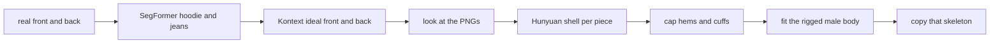

# Ideal images first, then two shells

Yes. This is the sequence to implement. Template 5 is the first outfit it runs on, and the same prepass is how later templates stop sending a flawed catalog photo straight into a reconstructor.

The photos are the reference. They are not the image Hunyuan sees. A model rewrites each garment into the picture the reconstructor was trained on: one object, fully in frame, nothing covering it, white background, front and back of that same piece. Then those pictures become the meshes.

## 1. Make the images before any mesh

[pipeline/clothes_seg.py](pipeline/clothes_seg.py) already labels upper and pants, then merges them. Split them. Template 5's upper is the hoodie. Pants are the jeans. Shoes stay out of this pass.

For each class, build a plate from the real photo, then send it through `black-forest-labs/flux-kontext-pro` on Replicate, the same client as [pipeline/reconstruct.py](pipeline/reconstruct.py). Two calls per class:

- Front, from the real front. Complete anything a hand or the other garment hides. Full piece in frame. White background. Same color, same cut, same graphic.
- Back, from the real back. Same rule. The back is not invented from the front.

The hoodie prompt names the chest graphic and says to keep it. The jeans prompt names the pocket stitching and the leather patch. Write:

- `outputs/canonical/5/hoodie/{front,back}.png`
- `outputs/canonical/5/jeans/{front,back}.png`

Look at those four files before spending a 3D call. If the teddy, the drawstrings, or the pocket hardware moved, tighten the prompt and run the image step again. Hunyuan only receives a pair that still looks like the product. A generated side view is not in this first run. Hunyuan treats every view as something it saw, and a profile that shifts the hem tears the flanks.

This prepass is the process change for the other templates too. A dress is one class instead of two. The same script, the same gate.

## 2. Turn those images into shells

One Hunyuan3D-2mv call per accepted pair, on Modal [cloud/modal_app.py](cloud/modal_app.py) `generate_3d_mesh`. Replicate is the fallback. Input is the ideal front and the ideal back, not the catalog photo and not a fused picture of the whole man. Save `outputs/canonical/5/hoodie-shell.glb` and `jeans-shell.glb`.

That avoids the fused statue: the waistband and the jeans are different meshes because they were different images.

Then, locally:

- Weld with `merge_vertices(merge_tex=True, merge_norm=True)`.
- Cap only sleeve cuffs, the hoodie waist, and the pant hems. Short inward rim, with UVs on the new faces. Leave the hood opening and the neck open. Do not run [pipeline/garment_extractor.py](pipeline/garment_extractor.py) `extract_garment` or `CLOSE_STEPS` on these shells. That carve is what cuts a hem that sticks a couple of millimetres past the mask, and the erosion drops drawstrings.
- Push each shell just outside [mannequins/mannequin_male.glb](mannequins/mannequin_male.glb) with the existing depth buffers. That file is already rigged (hips, spine, chest, neck, arms). The female mannequin has no skeleton, so templates 1–4 are not skinned in this pass.
- Copy `JOINTS_0` and `WEIGHTS_0` from the male mannequin in world space. The raw accessor is still lying down until the node transform is applied, so the nearest-neighbor search uses the standing mesh. New [pipeline/skinning.py](pipeline/skinning.py).
- Export one GLB: male body, hoodie primitive, jeans primitive, one armature.

Texture comes from the ideal images that passed the gate, projected front and back, with `cylindrical_unwrap` for the waist and hips. Hunyuan3D-Paint fills only the side band those views do not see.

## 3. The body toggle, beside that

Still bake the real photos onto both male bodies so the sidebar can compare them while the shells are in progress. This wrap is not the outfit pipeline. It does not animate and it does not split the garments.

- Basic: [mannequins/mannequin_male.glb](mannequins/mannequin_male.glb), one gray mesh, 696 vertices, about 1.78 m. The wrap will look faceted.
- Model: [mannequins/mannequin_male_model.glb](mannequins/mannequin_male_model.glb). Hair and shoes are at scale 0.01. Body, face, arms, legs, eyes, and teeth are at 0.001. Multiply those parts by 10, paint body, arms, and legs only, and leave the face.

[scripts/bake_male_bodies.py](scripts/bake_male_bodies.py) writes `5-wrap-basic.glb` and `5-wrap-model.glb`. A joined Basic / Model pair in [frontend/index.html](frontend/index.html) shows only on template 5. Template 5 stops loading the current `5-wrap.glb`, which is the hoodie on the female body.

The textured model is a different skeleton and the wrong scale, so it is not the weight source. The shells bind to the basic male rig.
