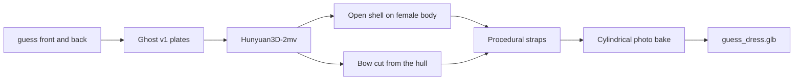

# Guess sequin dress on the female mannequin

The photos are one garment: a black sequin mini dress, straight satin bust band, thin straps, and a large satin bow on the back. [docs/build.md](docs/build.md) and [RULES.md](RULES.md) describe a men’s hoodie plus jeans. Those steps are the pipeline shape, not the outfit. There is no `scripts/generate_shape.py`, `scripts/build_outfit.py`, `cloud/flank_inpaint.py`, or `cloth2tex/meshes/hoodie.obj`.

Target body is [mannequins/female_base_mesh.glb](mannequins/female_base_mesh.glb). Its SDF is already cached at [mannequins/female_base_mesh.sdf.npz](mannequins/female_base_mesh.sdf.npz). One layer, so clearance is 4 mm, not the hoodie-over-jeans 8 mm. Output is `outputs/guess/guess_dress.glb` with two nodes, `mannequin` and `garment`, from `export_hybrid`.



## Why the dress cannot be a template warp

[third_party/cloth2tex](third_party/cloth2tex) has no dress. Its public Phase I registers a fixed template (`11_skirt`, tees, jackets) with a neural renderer, and the landmark detector is not in the repo. A skirt template will not become this bodice.

[third_party/Garment3DGen](third_party/Garment3DGen) does have [meshes/dress_shortsleeve.obj](third_party/Garment3DGen/meshes/dress_shortsleeve.obj). `loop.py` can warp that mesh toward a target hull through `NeuralJacobianFields/PoissonSystem.py`, but only as a library inside `main.py`. That entry point hardcodes `torch.device("cuda")` and `nvdiffrast`. It cannot run on this Mac. The short-sleeve dress also has no bow: Jacobian warps move existing vertices, and the project README says a dissimilar source and target fail. The bow is extra cloth, so it stays a piece cut from the Hunyuan hull.

The body shell uses the fitter already in this repo, [pipeline/garment_deformer.py](pipeline/garment_deformer.py) `fitted_shell`. It offsets the outer skin, keeps neck, armholes, and hem open, and eases toward the Hunyuan guide only outside the 4 mm clearance. That is the simulation-ready open boundary. The submodules do not replace it for this photo.

## 1. Ghost v1 plates

Opaque sequins. Do not run Flux Kontext (`write_dress_views`). A rewrite would invent the sequin field. Do not use the hoodie/jeans prompts in [pipeline/canonical.py](pipeline/canonical.py).

Add a dress plate next to `outfit_plate`: SegFormer label `DRESS` (id 7 in [pipeline/clothes_seg.py](pipeline/clothes_seg.py)), drop face and hair, close small holes so sequin highlights are not punched out, and LaMa-fill only the hand on the hip. Composite onto `#FFFFFF`. Straps may vanish in the mask; that is acceptable because they are rebuilt later. The bow must remain in the back plate.

Write:

- `outputs/canonical/guess/dress/front.png`
- `outputs/canonical/guess/dress/back.png`

Look at both before any 3D call. No sheer-fill. The cloth is opaque, and gray fill would flatten the sequins.

## 2. Coarse shape, both views

Send only those two plates to Hunyuan3D-2mv so the bow and the open upper back are in the hull. Local MPS cannot run it.

```bash
poetry run python scripts/run_hybrid_poc.py \
  --front outputs/canonical/guess/dress/front.png \
  --back outputs/canonical/guess/dress/back.png \
  --provider replicate \
  --product-shot \
  --build-only \
  --save-build outputs/guess/dress_raw.glb
```

`--product-shot` is the garment-only path in [scripts/run_hybrid_poc.py](scripts/run_hybrid_poc.py). It currently requires `--placement`. For this dress, either write a minimal `placement.json` from the plate bounds or allow product-shot without the leopard-slip placement file. Do not pass `--lift 0.10` blindly: that constant is for a different slip whose lace sat under the bust. Set the hem from this plate so the skirt ends at the upper thigh on `female_base_mesh.glb`.

Modal is the fallback if Replicate is unavailable: `poetry run modal run cloud/modal_app.py --front … --back …`.

## 3. Fit the shell, then cut the bow

Continue in `run_hybrid_poc` (or a thin `scripts/build_guess_dress.py` that calls the same functions) with:

- `--mannequin mannequins/female_base_mesh.glb`
- `--shell fitted`
- `--collision sdf`
- Hunyuan mesh as the guide inside `dress_band` (hem through bust, not the default hip-to-armpit window)

`fitted_shell` cannot grow the bow. After the shell is in mannequin space:

- Weld a copy of the aligned Hunyuan mesh with `merge_vertices(merge_tex=True, merge_norm=True)`.
- Do not call `trimesh.split()`.
- Keep back faces whose centroids sit well outside the shell (about 15 mm) in the bodice band. That component is the bow.
- Concatenate it with the open shell as the garment node.

## 4. Straps

Voxel Hunyuan drops the 1–2 px straps. [pipeline/straps.py](pipeline/straps.py) already builds two quad ribbons from the bandeau corners to the shoulder tops (`--straps`). Extend each ribbon over the shoulder to the back bodice at the bow knot so the back view matches the photo. Width about 6 mm. Attach before the texture bake.

## 5. Texture

Project the real front and back plates. Sequin pixels stay photographic.

- `--unwrap --unwrap-mode cylindrical` so the side seams get texel width. Planar wrap crushes the flanks.
- The bow is back-facing, so the back plate paints it.
- Grazing texels that no photo hits copy the nearest painted sequin on that UV island. That is the local flank fill.
- [cloud/flank_inpaint.py](cloud/flank_inpaint.py) is not in the repo. If the sides are still empty after the cylindrical bake, the existing Modal painter is `cloud/modal_app.py` with `--mesh` on the fitted GLB. Prompt for black sequin and the satin bow, not a grey hoodie. Do not add a new ControlNet worker unless that paint pass fails.

## Check before calling it done

- Front: sequin body, satin bust band, two straps, hem at upper thigh, no legs or shoes, 4 mm off the outer skin.
- Back: bow is mesh, not a flat print; straps meet the bodice; upper back stays open skin.
- Shell has boundary edges at neck, armholes, and hem (`fitted_shell` already refuses a closed mesh).
- Load `outputs/guess/guess_dress.glb` and orbit front, back, and one side. The static viewer only lists numbered templates, so this check is the GLB itself, not a new shop entry.
