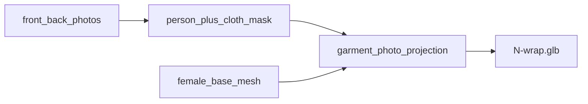

# Unify wrap, then 2× upscale

## What wrap is today

Wrap is **not** reconstruction. Front/back photos are projected onto `mannequins/female_base_mesh.glb`. Only garment pixels paint; leftover texels stay mannequin-white `(232, 229, 224)`. Script: [`scripts/test_mannequin.py`](scripts/test_mannequin.py) → [`pipeline/preprocess.py`](pipeline/preprocess.py) `load_view` → [`pipeline/texture_bake.py`](pipeline/texture_bake.py) `bake_photos`.



**1, 2, and 3 are not the same method:**

| Template | Wrap GLB | Method |
|----------|----------|--------|
| 1 | Oct 24 | `--cloth segformer --inpaint-occlusion` |
| 2 | Oct 11 restored | classic `u2net`, no LaMa |
| 3–5 | Oct 11–13 | classic `u2net`, no LaMa |

Default CLI is still `u2net`. SegFormer + bag/hair fill is opt-in and only shipped on template 1.

## Image quality (already using the full photos)

`test_images/` and `frontend/assets/templates/*-full.jpg` are **byte-identical 967×1450** JPEGs. The small files (`1-front.jpg` etc.) are **266×400 picker thumbs**, not wrap sources.

Wraps 1–5 were already baked from the 967×1450 files. Swapping in `test_images/` would change nothing. The atlas is **2048²**, so the photos are the bottleneck (~2× too small), not the frontend copies. There are no higher-res originals in the repo.

Do not pass picker thumbs. Always `*-full.jpg` (or the identical `test_images/` files).

## Phase 1 — same wrap as Template 1 on 2–5

Backup then rebuild, stock mannequin only (no `--mesh`):

```bash
poetry run python scripts/test_mannequin.py \
  frontend/assets/templates/N-front-full.jpg \
  frontend/assets/templates/N-back-full.jpg \
  --cloth segformer --inpaint-occlusion \
  --out frontend/assets/models/N-wrap.glb
```

- N = 2, 3, 4, 5. Leave `1-wrap.glb` as-is unless the rebuild proves the flags drifted.
- Backup current GLBs to `outputs/hybrid_src/N-wrap-u2net.glb`.
- Do not touch `*-build.glb` / `*-hybrid.glb`.
- LaMa 429: existing retry in [`pipeline/inpaint.py`](pipeline/inpaint.py); TELEA fallback if still throttled.
- Update [`frontend/js/app.js`](frontend/js/app.js) `WRAP_HINT` for 2–5 (SegFormer + LaMa, stock mannequin). Fix the stale INFO line that still says template 2 wraps onto Hunyuan. Bump `?v=`.
- Verify Wrap on 1–5 in the viewer (holes at bag/hair/straps vs old u2net).

## Phase 2 — 2× upscale before bake

967×2 ≈ 1934, which finally fills the 2048 atlas.

Add [`pipeline/upscale.py`](pipeline/upscale.py) via Replicate (same client as LaMa), e.g. `nightmareai/real-esrgan` with `scale=2`, `face_enhance=false` (wrap does not paint the face). Cache to `outputs/wrap_upscale/`. On 429/failure: keep the original photo, do not invent pixels.

Wire `--upscale 2` on [`scripts/test_mannequin.py`](scripts/test_mannequin.py): upscale RGB **before** `load_view` so the projected dress is sharp. SegFormer still downsamples internally; the win is texture, not the mask.

Then rebuild 1–5:

```bash
poetry run python scripts/test_mannequin.py \
  frontend/assets/templates/N-front-full.jpg \
  frontend/assets/templates/N-back-full.jpg \
  --cloth segformer --inpaint-occlusion --upscale 2 \
  --out frontend/assets/models/N-wrap.glb
```

Compare atlas PNGs (`N-wrap.png`) vs Phase 1. If Real-ESRGAN hallucinates lace/prints, stop and keep Phase 1.

## Out of scope

- Wrapping onto Hunyuan/TRELLIS (`--mesh`) — already tried, cracked UVs.
- Three-quarter side photos — none on disk for these five products.
- Re-scraping Revolve for bigger originals.
- Changing Hybrid (already overlays wrap-quality dress onto Full Build).
