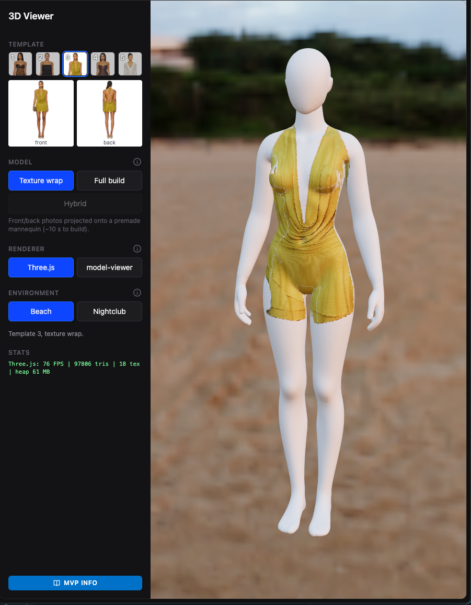
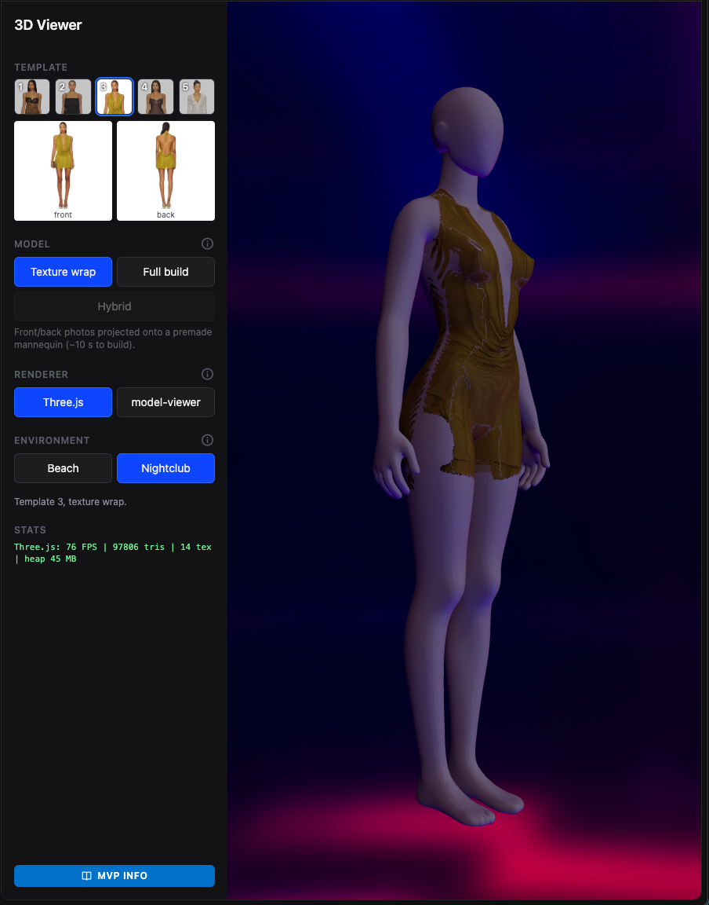
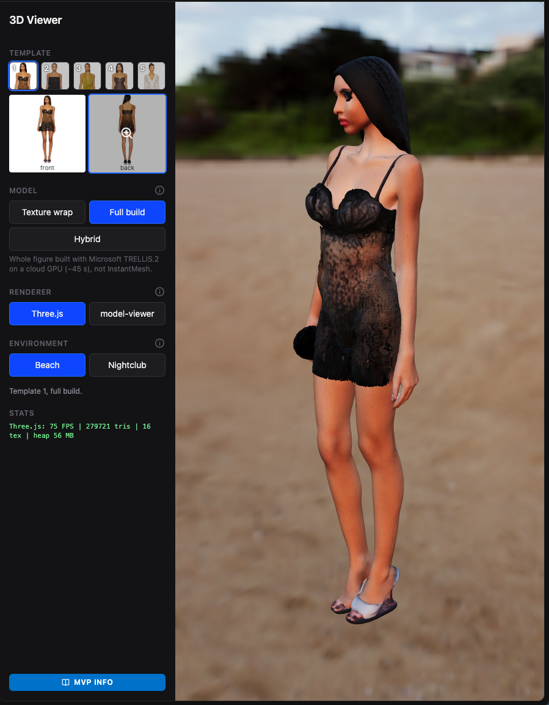
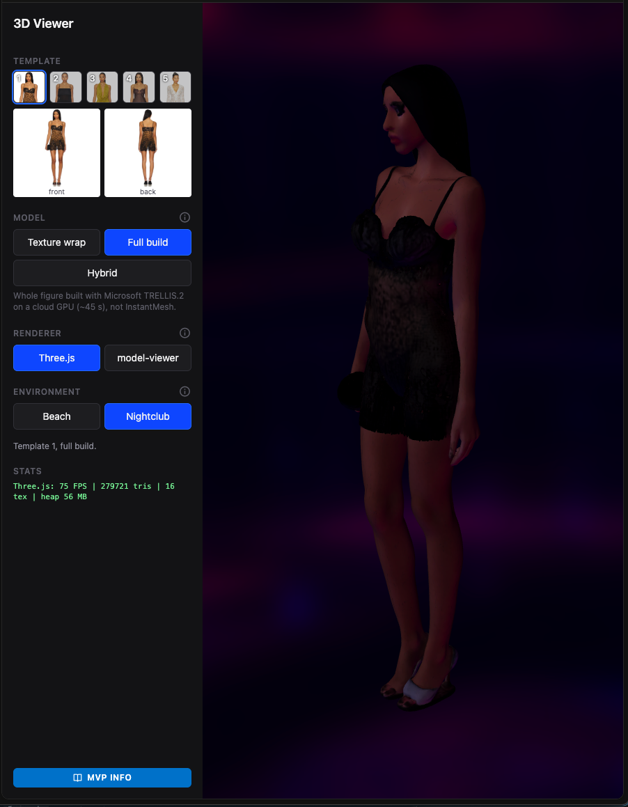

# 3D Viewer: product photos to 3D outfits

Turn a garment's ordinary product photos (one front shot and one back shot) into an interactive 3D model
that shoppers can spin around, shown on a clean, faceless mannequin in different lighting environments.

> **This is an MVP, and almost all of it was built and rendered locally.** Every model in the demo except
> one was generated on a single Mac Pro (AMD GPU, PyTorch MPS) using open-source models that run on a
> desktop. That made it cheap to explore, but it's the main reason quality is rough today. The one model we
> built on a cloud GPU (template 1, see below) is already much better, and quality would improve
> substantially with larger, newer models running on proper GPUs.

## Why 3D?

A 3D model of an outfit isn't tied to the lighting of the original photo shoot. Because the garment is
real geometry with a real texture, we can **relight it for any environment**: the same dress in bright beach
daylight or a dark club under pink and blue light. Shoppers see how an outfit actually reads where they'd
wear it, from any angle, which a flat photo can't show. Each environment is an HDR panorama that both lights
the model and forms the background, so adding a new setting is just adding a new panorama. The screenshots
below show the same viewer in beach and nightclub lighting.

## Two ways to get there: texture mapping vs. 3D model generation

We've built the 3D models two fundamentally different ways. Both work in both environments, and they fail
in opposite ways.

### Texture mapping: the photos wrapped onto a premade mannequin

| Beach (daylight) | Nightclub (low, tinted light) |
|---|---|
|  |  |

The garment's real photo pixels are projected onto the same clean, faceless mannequin every time.
**Great surface, no shape:** prints and colour are sharp and the look is consistent across products, but the
fabric is painted onto the body, so the hem cuts off at the legs instead of hanging. Built locally in ~10 s.

### 3D model generation: the whole figure reconstructed from the photos

| Beach (daylight) | Nightclub (low, tinted light) |
|---|---|
|  |  |

An AI model reconstructs the person and the outfit as new 3D geometry. This is template 1, generated with
Microsoft TRELLIS.2 on a cloud GPU in ~45 s. **Real shape, weaker surface:** the slip has real cups, straps and
a hem that stands off the body, but fine detail like the leopard print and lace is lost, and it reproduces the
person (face, hair, shoes) rather than a mannequin.

### The best option (probably): a hybrid

Since each approach is strong exactly where the other is weak, the most promising path is to **blend them:
take the garment's shape from 3D generation, put it on the clean mannequin, and project the real photo
textures onto that shape.** That gives real drape and silhouette *and* sharp, accurate prints, on a consistent
mannequin. There's a first prototype in the demo (template 1, **Hybrid**); it already gets the shape onto the
mannequin, and projecting the real photos onto it is the next step (see [What needs to be done](#what-needs-to-be-done)).

## Running the demo

```bash
source venv/bin/activate
uvicorn backend.app.main:app --port 8000
```

### From a fresh clone

Models, virtual environments and third-party model code are **not in git** (see `.gitignore`), so a clone
needs a few things added before the demo works:

- **3D models (`*.glb`):** copy `frontend/assets/models/` (the demo models) and `mannequins/` from an
  existing checkout or shared drive. Without them the viewer loads but shows nothing.
- **Python env:** `python3.11 -m venv venv && pip install -c backend/constraints.txt -r backend/requirements.txt`
  (TripoSR's `torchmcubes` build steps are in the comments of `backend/requirements.txt`).
- **Third-party model code** (only needed to regenerate models):
  `git clone https://github.com/VAST-AI-Research/TripoSR vendor/TripoSR` and
  `git clone https://github.com/TencentARC/InstantMesh vendor/InstantMesh` (InstantMesh runs in its own
  `venv-instantmesh/`, see `scripts/test_instantmesh.py`).

Then open <http://localhost:8000>. The demo is a picker, not an uploader. All models are pre-built, so
switching is instant:

- **Template 1-5:** five real products. Their source photos show under the thumbnails (click one for full size).
- **Model:** how the 3D model was built: *Texture wrap*, *Full build* or *Hybrid* (see below).
- **Renderer:** *Three.js* (default; custom lighting and live FPS stats) or Google's *model-viewer*.
- **Environment:** *Beach* or *Nightclub*.
- **ⓘ icons** explain each section, and **MVP INFO** at the bottom of the sidebar has the full write-up of
  what we tested and learned.

## Three ways to build the model

| | Texture wrap | Full build | Hybrid |
|---|---|---|---|
| **What it is** | Photos projected onto a premade mannequin | Whole figure reconstructed from the photos | Garment cut out of a full build, placed on the mannequin |
| **Templates** | 1-5 | 1-3 | 1 |
| **Where it ran** | Locally, CPU | Locally, CPU + AMD GPU (template 1: cloud GPU) | Locally, CPU (on top of the cloud build) |
| **Time per product** | ~10 s | ~6.5 min locally / ~45 s on cloud GPU | ~10 s plus the full build |
| **Strength** | Clean, consistent, sharp prints | Real garment shape (skirts hang, hems flare) | Real shape on a clean mannequin |
| **Weakness** | No shape: skirts get painted onto the legs | Lumpy, blurry, reproduces the person | Gaps at the sides, skin-coloured patches in sheer fabric |

### Texture wrap
The front and back photos are projected directly onto a premade mannequin (`mannequins/female_base_mesh.glb`).
A clothing-segmentation model (rembg's `u2net_cloth_seg`) masks out everything that isn't the garment, so
skin, hair and accessories stay mannequin-white. Script: `scripts/test_mannequin.py`.

### Full build
- **Templates 2-3 (local):** Zero123++ imagines six views around the person from the front photo, the real
  back photo replaces the imagined back views, and InstantMesh reconstructs a mesh from them. On the Mac this
  needs the view generation and mesh extraction on CPU (the AMD GPU runs out of memory), hence ~6.5 minutes
  and rough results. Script: `scripts/test_instantmesh.py` (own venv: `venv-instantmesh/`).
- **Template 1 (cloud):** built with [Microsoft TRELLIS.2](https://huggingface.co/spaces/microsoft/TRELLIS.2)
  on a cloud GPU via its Hugging Face Space, in **about 45 seconds**. The result is a cleaner, properly
  textured mesh, and it's the clearest evidence of how much better models and hardware help.

### Hybrid (first prototype)
Takes the best of both: the garment's **shape** from the full build and the **body** from the mannequin. The
clothing masks are projected onto the TRELLIS.2 mesh to cut out the garment, the person is discarded, and the
garment is fitted onto the mannequin. Script: `scripts/build_hybrid.py`.

## Where we are

**Working**
- An end-to-end demo with five products, three build methods, two renderers and two lighting environments.
- Texture wrap for every product; full builds for three; a working hybrid for one.
- Measured results and a write-up of every approach we tried (in the app under **MVP INFO**).

**Limitations of the MVP**
- **Local models and hardware.** Everything except template 1's full build was generated on a desktop Mac
  with open-source models. The AMD GPU (Metal/MPS) can't run much of the modern 3D tooling, which assumes
  NVIDIA CUDA, and its ~10 GB memory limit pushed the heavy steps onto the CPU.
- **Invented backs.** Most single-image models only look at the front photo and guess the back. We feed in
  the real back photo where we can, but the sides are still guessed.
- **Texture wrap has no garment shape**, so loose skirts and long coats read as shorts or leggings.
- **Large files.** Template 1's cloud build and hybrid are 13-17 MB; nothing is compressed yet.

## What needs to be done

### 1. Cloud GPUs and better models
This is the single biggest quality lever. TRELLIS.2 on a cloud GPU took **~45 s** versus **~6.5 min**
locally, and looks far better.
- Run all builds on NVIDIA GPUs (cloud), generated **once per product, offline**, and serve the finished file.
- Run TRELLIS.2 on templates 2-5, then compare it with other candidates:
  - **Hunyuan3D-2 (multi-view):** designed to take several real views, so our back photo is a real input.
  - **Clothed-human models (ECON, SiTH):** understand there's a body under the clothes.
- Use the products' **three-quarter photos**, which we don't use yet, to cover the sides.
- Longer term: fine-tune on our own studio angles and garments.

### 2. A production hybrid (the likely best option)
The recommended path: mannequin body + reconstructed garment shape + **real photos projected onto the
garment** for sharp, accurate colour (today the hybrid still uses the model's own texture). Fill the hidden
areas from the three-quarter shot and image inpainting.

### 3. Better rendering
- **Compress models** (Draco geometry, KTX2 textures) so they load fast on phones.
- **Better materials and lighting:** proper fabric materials (sheen, transparency for sheer fabrics), soft
  shadows, more environments, and tuned exposure per environment.
- **Choose the production viewer:** Three.js for custom scenes and lighting like the nightclub (the current
  default), model-viewer for a drop-in product-page widget with AR on phones.

### 4. Productising
A job queue for builds, automatic quality checks (render the model from the photo angles and compare it with
the real photos), and a fixed benchmark set of products to track quality as models improve.

## Project layout

| Path | What it is |
|---|---|
| `frontend/` | The demo UI: `index.html`, `js/app.js`, `js/three-viewer.js`, `js/mvp-info.js` (Tailwind + Boxicons via CDN, no build step) |
| `frontend/assets/models/` | Pre-built models: `<template>-wrap.glb`, `-build.glb`, `-hybrid.glb` |
| `frontend/assets/hdri/` | Environment panoramas (beach, disco) |
| `backend/app/` | FastAPI server: serves the frontend and an `/api/generate` endpoint (TripoSR single view) |
| `scripts/` | Build scripts: `test_mannequin.py`, `test_instantmesh.py`, `build_hybrid.py`, `test_triposr.py` |
| `mannequins/` | Premade mannequin meshes |
| `test_images/` | Source front/back product photos |
| `vendor/` | Third-party model code (TripoSR, InstantMesh) |
| `_docs/` | Planning notes and screenshots |

See `CLAUDE.md` for developer details, including several mesh quirks that are worth knowing before touching
the hybrid pipeline.
