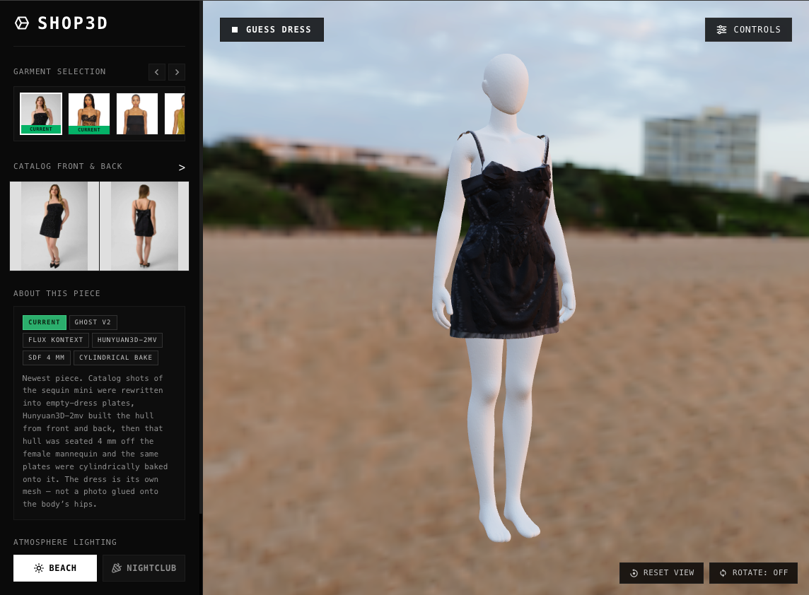
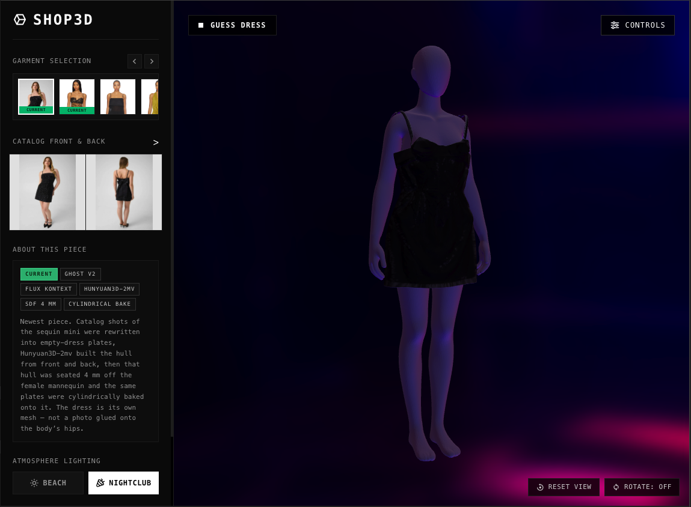

# 3D Viewer: Product Photos to 3D Outfits

Turn a garment’s ordinary product photos (one front shot and one back shot) into an
interactive 3D model that shoppers can spin around. The garment is its own mesh,
fitted to a clean faceless mannequin, under relightable HDRI environments.

Shop3D with the current Guess sequin mini, in the two lighting environments:

| Beach | Nightclub |
| :---: | :---: |
|  |  |

> **Current state.** The product demo is **Shop3D** (`/shop.html`). The Guess dress is
> the newest piece: empty-dress plates (Ghost v2 / Flux Kontext), Hunyuan3D-2mv hull
> from front and back, 4 mm SDF clearance off `female_base_mesh.glb`, cylindrical
> photo bake. The dress is geometry, not a photo glued onto the body’s hips.
>
> Early experiments ran locally on a Mac Pro (AMD GPU, PyTorch MPS). Shape and paint
> that need CUDA go to **Replicate** and **Modal**. `/` is still the TESTBED lab
> (wrap / build / hybrid side-by-side). `/api/generate` is a live TripoSR scaffold
> and is not what the shop uses.

---

## 1. Two viewers

| URL | What it is |
|---|---|
| [http://127.0.0.1:8000/shop.html](http://127.0.0.1:8000/shop.html) | Shop3D. Catalog of fitted garments, catalog front/back, method chips, Beach / Nightclub lighting, specs modal. |
| [http://127.0.0.1:8000/](http://127.0.0.1:8000/) | TESTBED. Numbered templates 1–5 with Texture wrap / Full build / Hybrid, plus Three.js vs `<model-viewer>`. |

Shop3D reads `frontend/items.json`. Several current meshes live under `outputs/`
(gitignored). The FastAPI app mounts that folder at `/outputs`, so a local run
needs those GLBs on disk.

---

## 2. How the pipeline works

The settled rule: **never send a raw catalog person to a 3D reconstructor.**
Isolate the garment in 2D first, build a coarse hull from both views, seat that
hull on the mannequin, then project the real photo pixels back onto it.

```
Catalog front + back
        │
        ▼
  2D pre-pass (material-aware)
   Ghost v1  ·  Ghost v2 / Flux Kontext  ·  sheer-fill (24,24,24)
        │
        ▼
  Hunyuan3D-2mv  (front + back plates only)
        │
        ▼
  Keep the hull  →  align to mannequin  →  SDF push 4 mm
        │
        ▼
  Cylindrical bake of the same plates
        │
        ▼
  export_hybrid  →  mannequin + garment GLB
```

Shape and texture are separate services. Hunyuan sees empty product shots and
returns a grey hull. The catalog (or Kontext) pixels are baked afterward. That
is why sequins, leopard mesh, and chest graphics stay photographic instead of
being redrawn by a paint model.

### Step 1 — 2D pre-pass

`scripts/make_canonical_views.py` plus `pipeline/prepass.py`. Outfit JSON in
`configs/templates/` chooses the path.

| Mode | When | What it does |
|---|---|---|
| **Ghost v1** | Opaque cloth (satin slip) | SegFormer + rembg + LaMa. Keep real garment pixels, drop skin / hair / bag, composite on `#FFFFFF`. |
| **Ghost v2** | Sheer, lace, sequins, busy prints | Flux Kontext Pro (`black-forest-labs/flux-kontext-pro` on Replicate) rewrites the catalog into an empty, straight product shot. SegFormer labels leopard mesh as “skin” and punches it out; a rewrite does not. |
| **Sheer-fill** | Hollow / see-through regions, Hunyuan only | Copy of the accepted PNG with enclosed hollows filled RGB `(24, 24, 24)`. Reconstructors treat white-through-cloth as holes and tunnel the midriff. Texture plates stay untouched. |
| **Graphic preserve** | Chest logos / prints | Ghost v1 only. Cut the real pixels (`graphic_region_bbox`) back onto the plate. Ghost v2 is refused when `preserve_graphics` is set. |

Look at `front.png` / `back.png` before any 3D call. A bad plate is not fixed in 3D.
`placement.json` stores the catalog person box and dress box (in catalog pixels)
so the fitter can put the resized plate back onto the body.

### Step 2 — Coarse shape

Hunyuan3D-2mv on Replicate (`tencent/hunyuan3d-2mv`) or Modal A10G
(`cloud/modal_app.py`). Both front and back plates go in, so an open back, cowl,
or satin bow is in the mesh instead of hallucinated.

Do not run this locally. PyTorch MPS on the Mac Pro has no CUDA rasterizer.

Single-view models (TRELLIS.2, TripoSR, InstantMesh) invent the back. They are
kept as comparisons in TESTBED, not as the shop path.

### Step 3 — Fit the hull, do not replace it

The garment that Hunyuan built **is** the dress. Alignment and collision happen
to that mesh:

1. `align_ghost_to_mannequin` scales by the 2D garment-to-person height and sits
   the hem from the plate, not from a full-body bbox.
2. `push_clearance` walks vertices ~4 mm outside the outer skin using a cached
   SDF (`mannequins/female_base_mesh.sdf.npz`).
3. `export_hybrid` writes two nodes: `mannequin` and `garment`.

`fitted_shell` (cut a band of the mannequin and use Hunyuan only as a guide) is
the path that produced shredded sequins painted on hips. Do not use it for a
mini with drape, a bow, or a skirt. `scripts/build_outfit.py` is the fitter that
keeps the hull.

The mannequin is a double-skinned ~5 mm shell with scrambled winding.
`mesh.contains()` and vertex-normal collision point the wrong way. Always SDF
or orthographic depth buffers.

Layered outfits (hoodie over jeans) stack clearance: jeans 4 mm off the body,
hoodie 4 mm off the jeans.

### Step 4 — Texture

`bake_photos` in `pipeline/texture_bake.py`. Default for dresses is
`cylindrical_unwrap` so the flanks have texel width. Planar front/back charts
crush 90° triangles to a line and leave grey under-arm strips.

Facing photos win (`clip(|n · view|)`). Grazing texels copy the nearest painted
texel on the same UV island. Left/right plates, when they exist, are texture
only — they are not sent to Hunyuan. OpenCV TELEA is a last resort and smears
prints; do not use it as the main flank fill.

Thin spaghetti straps vanish on a 384³ voxel grid. `pipeline/straps.py` can add
6 mm quad ribbons from bandeau corners to the shoulders after fit, before bake.

### Step 5 — What the shop loads

Shop3D shows the fitted GLB. The specs modal can load the unfitted Hunyuan hull
so you can compare shape before seating.

---

## 3. What’s on the rack

Five garments in Shop3D. “Current” means this is the version we would show.

| Piece | File | How it was made | What it proved |
|---|---|---|---|
| **Guess dress** (current) | `outputs/guess/guess_dress_hull.glb` | Ghost v2 plates, Hunyuan hull, SDF 4 mm, cylindrical bake of front+back | Keep the hull. Sequins stay photographic. The earlier `guess_dress.glb` (`fitted_shell`) is the failure left on disk. |
| **Leopard dress** (current) | `outputs/canonical/1/dress-fitted.glb` | Ghost v2 (mask deletes the print), Hunyuan from front+back, cylindrical 4-view | Sheer prints cannot use Ghost v1. Planar hybrid (`1-hybrid.glb`) left grey flanks; cylindrical side-fill is the current mesh. |
| **Open Leg** | `outputs/canonical/2/dress-fitted.glb` | Ghost v2 + sheer-fill, Hunyuan, cylindrical 4-view | White through sheer is a hole unless you fill it for Hunyuan. The slit has to stay open in the vision plate or it becomes a solid panel. |
| **Yellow Dress** | `frontend/assets/models/3-hybrid.glb` | Hunyuan full figure from catalog front+back, Hunyuan3D-Paint on Modal, photo overlay | Multi-view is required for an open back. No mannequin — skin and flanks keep Paint. |
| **Satin slip** | `frontend/assets/models/4-hybrid.glb` | Ghost v1 cutouts, Hunyuan dress-only, `fit_ghost_garment` | Opaque cloth can be masked. Feeding the person to Hunyuan builds a person. |

TESTBED still has the older wrap / TRELLIS / InstantMesh files under
`frontend/assets/models/<n>-{wrap,build,hybrid}.glb` so those methods can be
compared on the same photos.

Hoodie + jeans (`configs/templates/hoodie_jeans_layered.json`,
`scripts/build_male_outfit.py`) is the layered-SDF path on
`mannequins/male_base_mesh.glb`. It is not on the shop rack yet. The hoodie
chest graphic is a Ghost v1 preserve, not a Kontext rewrite.

---

## 4. Reconstructors we evaluated

| Method | Runtime | Strength | Why it is not the shop default |
|---|---|---|---|
| Texture wrap | ~10 s CPU, photos on `female_base_mesh.glb` | Sharp prints, clean body | Zero garment shape. Skirts paint onto legs. |
| InstantMesh + Zero123++ | ~6.5 min local CPU | Runs on this Mac | Low-res, vertex colour, invented views. |
| TRELLIS.2 | ~45 s HF Space / Replicate | Clean geometry and UVs | Single-view: invents the back. Unusable when the back has a zipper, keyhole, or bow. |
| Hunyuan3D-2mv | Replicate or Modal A10G | Native front+back | Grey hull; side seams if you trust its paint. We take the shape and bake our plates. |
| Hunyuan3D-Paint | Modal A10G | Fills grazing flanks | Blurry, bakes lighting in. Used on the yellow full-figure, not on Guess. |
| Hybrid, keep the hull | Local MPS/CPU after the cloud call | Real drape + real pixels on a standard body | This is the current path. |

---

## 5. Hard constraints (paid for in debugging time)

- **Hardware.** Mac Pro, AMD GPU, `torch.device("mps")`. No custom CUDA
  (`nvdiffrast`, GPU marching cubes). Heavy diffusion and rasterization go to
  cloud workers.
- **Mannequin.** `mannequins/female_base_mesh.glb` is a joined inner+outer skin
  ~5 mm apart with inverted winding. SDF or 2D depth buffers only.
- **AI meshes.** Hunyuan and TRELLIS split vertices on UV seams. Weld a copy with
  `mesh.merge_vertices(merge_tex=True, merge_norm=True)` before connectivity.
  Never `trimesh.split()` on a textured mesh — it clones the atlas per component
  and exhausts RAM. Use `trimesh.graph.connected_component_labels`.
- **Coordinates.** glTF: +Y up, +Z toward the camera, +X model left.

---

## 6. Cloud services

| Service | Used for |
|---|---|
| **Replicate** | Hunyuan3D-2mv shape, Flux Kontext empty-dress edits, LaMa occlusion fill (`allenhooo/lama`), TRELLIS.2 |
| **Modal** | Hunyuan3D-2mv and Hunyuan3D-Paint on A10G (`cloud/modal_app.py`), HF weights on a persistent volume |
| **Hugging Face** | SegFormer clothes parser (`mattmdjaga/segformer_b2_clothes`, forced CPU — MPS logits are wrong here), TRELLIS.2 Space, model weights |

Tokens live in `.env` (`REPLICATE_API_TOKEN`, `HF_TOKEN`). Copy from `.env-base`.
Never commit `.env`.

```bash
make modal-setup     # browser login, once
make modal-secret    # huggingface-secret from HF_TOKEN
make modal-deploy    # first image build can take 20–40 min
make modal-prefetch  # optional: warm the HF volume
```

---

## 7. Running the app

```bash
./run.sh          # FastAPI + static viewer on http://127.0.0.1:8000
make run          # same, via Poetry
```

Shop3D: [http://127.0.0.1:8000/shop.html](http://127.0.0.1:8000/shop.html)
TESTBED: [http://127.0.0.1:8000/](http://127.0.0.1:8000/)

Install (Poetry, Python 3.11): `make install`.
`poetry run python scripts/verify_mps.py` checks that MPS is usable.
`poetry run pytest tests/ -q` covers prepass routing, SDF, mesh invariants,
bows and straps — no Replicate calls.

---

## 8. Rebuilding a piece

Outfit JSON declares material, pre-pass, clearance, and unwrap. Example:
`configs/templates/guess_dress.json`.

**Plates** (look at the PNGs before continuing):

```bash
poetry run python scripts/make_canonical_views.py \
  --config configs/templates/guess_dress.json \
  --front test_images/guess_front.png \
  --back  test_images/guess_back.png
```

**Shape** (skip if `outputs/shape/guess_dress/dress_raw.glb` is already good):

```bash
poetry run python scripts/run_hybrid_poc.py \
  --front outputs/canonical/guess_dress/dress/front.png \
  --back  outputs/canonical/guess_dress/dress/back.png \
  --placement outputs/canonical/guess_dress/dress/placement.json \
  --provider replicate \
  --product-shot \
  --build-only \
  --save-build outputs/shape/guess_dress/dress_raw.glb
```

Modal fallback: `poetry run modal run cloud/modal_app.py --front … --back …`.

**Fit + cylindrical bake** (keeps the hull):

```bash
poetry run python scripts/build_outfit.py \
  --config configs/templates/guess_dress.json \
  --shell dress=outputs/shape/guess_dress/dress_raw.glb \
  --out outputs/guess/guess_dress_hull.glb
```

Do not run `scripts/run_fitting.py` / `scripts/assemble_dress.py` as the Guess
build. Those replace the dress with a mannequin band (`fitted_shell`) or glue on
a height-field bow. `--sheer-fill` is for Open Leg, not for opaque sequins.
`--straps` only if the hull’s own strap loops are unusable.

Generic hybrid PoC (older TESTBED path):

```bash
poetry run python scripts/run_hybrid_poc.py \
  --front frontend/assets/templates/1-front.jpg \
  --back  frontend/assets/templates/1-back.jpg \
  --provider replicate \
  --out frontend/assets/models/1-hybrid.glb
```

`--provider skip --build path.glb` reuses an existing hull (no GPU). After writing
a new `<n>-hybrid.glb`, add `n` to `HAS_HYBRID` in `frontend/js/app.js`.

---

## 9. Project layout

| Path | Description |
|---|---|
| `frontend/shop.html`, `frontend/js/shop.js`, `frontend/items.json` | Shop3D catalog |
| `frontend/index.html`, `frontend/js/app.js` | TESTBED template picker |
| `frontend/assets/models/` | Pre-built wrap / build / hybrid GLBs |
| `frontend/assets/hdri/` | Beach (`umhlanga_sunrise_1k.hdr`) and Nightclub (`disco.hdr`) |
| `backend/app/` | FastAPI: static UI, `/outputs`, `/api/generate` |
| `pipeline/` | Pre-pass, reconstruct, SDF, bake, export, straps |
| `scripts/make_canonical_views.py` | 2D plates (Ghost v1 / v2 / sheer-fill) |
| `scripts/run_hybrid_poc.py` | Cloud reconstruct + optional extract/bake |
| `scripts/build_outfit.py` | Keep-the-hull SDF fitter + bake |
| `configs/templates/` | Per-outfit JSON |
| `cloud/modal_app.py` | Hunyuan3D-2mv + Paint on A10G |
| `mannequins/` | `female_base_mesh.glb` (+ `.sdf.npz`), male bodies |
| `outputs/` | Canonical plates, raw hulls, fitted GLBs (gitignored) |
| `tests/` | Prepass, SDF, mesh, strap unit tests |
| `third_party/cloth2tex`, `third_party/Garment3DGen` | Topology research checkouts (CUDA; not the Guess path) |

For agent-oriented pipeline rules see **[AGENTS.md](AGENTS.md)**. For mesh
gotchas and setup commands see **[CLAUDE.md](CLAUDE.md)** and **[CODE.md](CODE.md)**.
Session notes for each garment live under `history/`.
