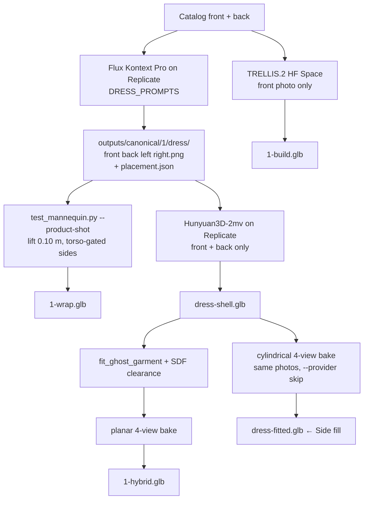

# Template 1 — Leopard lace mini slip

Sheer mesh over skin, two spaghetti straps, lace bust, upper-thigh hem, black clutch on the hip. This is the template that forced **rewrite the photo, don’t mask it**.

Related method notes: [`_docs/ghost-v2.md`](../_docs/ghost-v2.md), [`_docs/trellis.md`](../_docs/trellis.md), [`_docs/t1-sidefill-handoff.md`](../_docs/t1-sidefill-handoff.md).

## What’s in the viewer

| Button | File | What it is |
| --- | --- | --- |
| Texture wrap | `frontend/assets/models/1-wrap.glb` | Ideal dress photos painted onto `mannequins/female_base_mesh.glb`. No garment geometry. |
| Full build | `frontend/assets/models/1-build.glb` | Whole person from **TRELLIS.2** (front photo only). Independent of wrap/hybrid. |
| Hybrid | `frontend/assets/models/1-hybrid.glb` | Hunyuan dress shell on the white mannequin. **Planar** 4-view bake (27 Oct). Demo file. |
| Side fill | `outputs/canonical/1/dress-fitted.glb` | Same shell as Hybrid, **cylindrical** 4-view bake (29 Oct). Preview only. |
| Sim2 thumbs | `outputs/canonical/1/dress/{front,back,left,right}.png` | Flux Kontext empty-dress photos. |

`HAS_WRAP` / `HAS_BUILD` / `HAS_HYBRID` all include `1`. Side fill is shown because Hybrid and the cylindrical preview are different files (`hasSideFill()` in `frontend/js/app.js`).

Catalog photos: `frontend/assets/templates/1-{front,back}.jpg` (and `-full.jpg`).

## Why this garment is hard

SegFormer (`mattmdjaga/segformer_b2_clothes`) labels the leopard mesh as **skin**. A Ghost-v1 cut (the Template 4 path) deletes the print. So T1 does not isolate the dress with a mask. Flux Kontext rewrites the catalog shot into a picture of the empty slip, and that picture is the input to wrap and Hunyuan.

The catalog body ratio also lands the lace **under** this mannequin’s bust. `DRESS_LIFT_M = 0.10` in `pipeline/canonical.py` shifts bust and hem up together so the lace covers the chest and the hem stays a mini.

## Flow that shipped



Two independent 3D shapes: TRELLIS is the clothed person; Hunyuan is the empty dress. Hybrid does **not** cut the TRELLIS mesh.

## 1. Ideal photos (Sim2)

**Code:** `DRESS_PROMPTS` and `write_dress_views` in `pipeline/canonical.py`. Entry: `scripts/make_canonical_views.py --dress`.

```bash
poetry run python scripts/make_canonical_views.py --dress \
  --front test_images/front.jpg \
  --back  test_images/back.jpg \
  --out outputs/canonical/1/dress
```

(Catalog full photos are the same garment; the CLI defaults to `test_images/`.)

| View | How it is made |
| --- | --- |
| Front | Kontext edit of the catalog **front** |
| Back | Kontext edit of the catalog **back** |
| Left / right | 90° turns of the **accepted front**. Texture only. |

Prompts pin a **short mini**: upper-thigh hem, two thin straps, lace bust, leopard mesh, scalloped lace hem. The first pass lengthened it into a midi with a second lace skirt and was rejected. Do not regenerate `front.png` / `back.png` unless they are missing.

`placement.json` is the SegFormer person box plus a sheer-aware bust-to-hem (`grow_sheer`). Product shots are centered and have no feet; `load_product_view` pastes the garment back into the catalog person frame before measuring against the body.

## 2. Texture wrap

**Code:** `scripts/test_mannequin.py` with `--product-shot`. Bake: `pipeline/texture_bake.py`.

```bash
poetry run python scripts/test_mannequin.py \
  outputs/canonical/1/dress/front.png \
  outputs/canonical/1/dress/back.png \
  --left  outputs/canonical/1/dress/left.png \
  --right outputs/canonical/1/dress/right.png \
  --product-shot \
  --placement outputs/canonical/1/dress/placement.json \
  --out frontend/assets/models/1-wrap.glb
```

Lift is applied when placing the product shots. Profile photos paint only where `|x| < TORSO_SIDE_X` (0.18 m). Past that the surface is an arm and stays mannequin-white.

**Works:** sharp print, consistent faceless body, mini length, bare arms.  
**Does not:** the dress is paint. Straps, cups, and hem are not geometry.

## 3. Full build

**Code:** `pipeline/reconstruct.py` → `via_hf_space` (`microsoft/TRELLIS.2`). CLI: `scripts/run_hybrid_poc.py --provider trellis --build-only`.

Front photo only, ~45 s on the Hugging Face Space, 2K baked UV, scaled to mannequin height. The texture is continuous (including sides the photo never saw). The **back is invented**.

Left alone when Ghost v2 redid wrap and hybrid. Do not overwrite `1-build.glb` from a hybrid run: always pass `--no-write-build`.

## 4. Hybrid (planar, demo)

**Code:** `scripts/run_hybrid_poc.py --product-shot`. Place: `fit_ghost_garment` in `pipeline/garment_extractor.py`. Clearance: `pipeline/sdf_collision.py` (not `mesh.contains()` — this mannequin is a double-skinned shell with scrambled winding). Bake: planar unwrap.

Hunyuan gets **front and back only**. Sending left/right as shape tears the hem; the generated profiles do not share a hemline.

Export is two nodes, `mannequin` and `garment`, so they can be rigged later. The default hip-to-armpit push hid this mini inside the hips; product-shot mode pushes from **hem through bust** (`dress_band`).

Shell kept at `outputs/canonical/1/dress-shell.glb`. Demo file dated 27 Oct.

## 5. Side fill (cylindrical preview)

Same Hunyuan shell, no new Flux, no new Hunyuan, no `--shell fitted`. Texture-only rebake with cylindrical UVs so the Sim2 left/right photos actually land on the flanks.

```bash
.venv/bin/python scripts/run_hybrid_poc.py \
  --front outputs/canonical/1/dress/front.png \
  --back  outputs/canonical/1/dress/back.png \
  --left  outputs/canonical/1/dress/left.png \
  --right outputs/canonical/1/dress/right.png \
  --placement outputs/canonical/1/dress/placement.json \
  --product-shot --provider skip \
  --build outputs/canonical/1/dress-shell.glb \
  --no-write-build --unwrap-mode cylindrical \
  --collision sdf \
  --out outputs/canonical/1/dress-fitted.glb
```

Bake log: `uv=cylindrical`, ~96% of surface painted, island-copy filled the rest, TELEA 0. Garment `y` ≈ 0.89–1.54 m (mini).

Side compare splats: `outputs/canonical/1/hybrid-{left,right}.png` (planar Hybrid — white holes on flanks) vs `preview-{left,right}.png` (cylindrical — leopard + lace continue).

**Do not** copy this over `1-hybrid.glb` unless that is an explicit product decision. Keep the Oct 27 planar file.

## Dead ends (do not redo)

- Ghost-v1 / SegFormer cut on this slip — deletes the leopard mesh.
- `--shell fitted` as the T1 product mesh — looked like a painted torso. Compare lives at `outputs/fit_compare/1-sdf-shell.glb`.
- Feeding left/right into Hunyuan.
- Regenerating Flux fronts that already look right (an earlier prompt grew a midi).
- Carving the TRELLIS person to get a dress (that was the first hybrid prototype in `frontend/js/mvp-info.js`; Hybrid today is a separate Hunyuan shell).

## What to steal for a later flow

1. **Ideal photos before 3D** when a mask would destroy the print.
2. **Hunyuan for shape, photos for texture.** Sides are texture, not extra views into the reconstructor.
3. **Cylindrical unwrap + four views** when the complaint is holes on the flanks. Planar wrap is the thing that failed here, not the shell.
4. **SDF clearance** on `female_base_mesh.glb` (depth-buffer `zpush` is the older compare).
5. **`--no-write-build`** so experiments cannot clobber TRELLIS.
