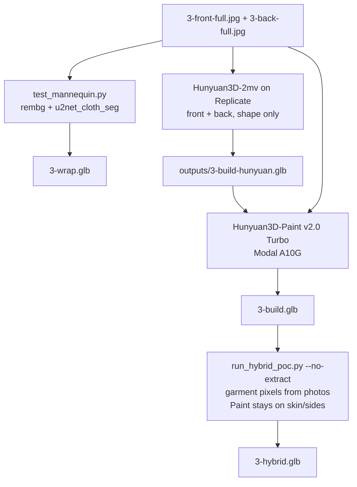

# Template 3 — Chartreuse halter mini

Olive/chartreuse halter: deep cowl, open back, neck tie, clutch in the left hand. The **back photo is the reason this template exists**. A front-only reconstructor will invent a closed back.

Longer write-up with the same facts: [`_docs/template3.md`](../_docs/template3.md). Diagram: [`_docs/diagrams/template3.d2`](../_docs/diagrams/template3.d2).

## What’s in the viewer

| Button | File | What it is |
| --- | --- | --- |
| Texture wrap | `frontend/assets/models/3-wrap.glb` | Catalog photos projected onto `female_base_mesh.glb`. Cowl and open back are paint. |
| Full build | `frontend/assets/models/3-build.glb` | Hunyuan3D-2mv **shape** (Replicate, front+back) + Hunyuan3D-Paint (Modal A10G). Whole figure. |
| Hybrid | `frontend/assets/models/3-hybrid.glb` | That same painted figure with catalog dress photos laid over the garment. Skin/sides keep Paint. No mannequin. |

No Sim2 row. Reconstruction inputs are the studio shots `frontend/assets/templates/3-{front,back}-full.jpg` (967×1450). Thumbs are picker-only.

The sidebar wrap hint still mentions “2× upscale, Ghost isolation, waist–hip warp”. **That is not the file in the viewer.** `3-wrap.glb` is the plain stock-mannequin projection. Flags for those extras live on `scripts/test_mannequin.py` and were not used for this GLB.

## Why this garment is hard

The thing to match is the **open back**. TRELLIS.2 (T1 full build) is the wrong tool: one front photo, invented back. InstantMesh was the first local full build and is kept only as `outputs/3-build-instantmesh.glb`.

Hunyuan3D-2mv on Replicate returns **geometry only** (solid grey). Photo-projecting onto that mesh paints ~83% of the surface; the other 17% is the band neither photo sees (under-arm sides, outer arms, skirt edges). Those texels stay grey seams. Hunyuan3D-Paint is the step that covers them. Replicate’s 2mv endpoint cannot run Paint; that is why Modal exists.

## Flow that shipped



## 1. Texture wrap

**Code:** `scripts/test_mannequin.py` → `pipeline/texture_bake.py`. ~10 s CPU.

```bash
poetry run python scripts/test_mannequin.py \
  frontend/assets/templates/3-front.jpg \
  frontend/assets/templates/3-back.jpg \
  --out frontend/assets/models/3-wrap.glb
```

rembg cuts the person, `u2net_cloth_seg` keeps garment pixels, skin/hair stay mannequin-white. Nothing is reconstructed.

**Works:** sharp print, clean consistent body.  
**Does not:** cowl drape, open back, hem as geometry. A second wrap pass on the stock mannequin will not create those. The useful reuse of this projection is Hybrid, on the Hunyuan mesh, dress pixels only.

Backup of an older wrap: `outputs/3-wrap-oct13-backup.glb`. Sleeve experiment: `outputs/3-wrap-sleeves.glb`.

## 2. Full build — shape, then paint

**Shape.** `pipeline/reconstruct.py` `via_replicate`, model `tencent/hunyuan3d-2mv`. Front and back. ~80k faces, y-up, facing +Z, solid grey → `outputs/3-build-hunyuan.glb`.

**Failed color attempt.** `pipeline/texture_bake.py` projecting real photos, front +Z / back −Z, TELEA on holes → `outputs/3-build-colored.glb`. Grey side seams. Not in the viewer.

**Paint.** `cloud/modal_app.py` `paint_3d_mesh`: compiles Hunyuan’s CUDA rasterizer, runs `Hunyuan3DPaintPipeline` from `tencent/Hunyuan3D-2`, subfolder `hunyuan3d-paint-v2-0-turbo`, on an A10G. Input = grey mesh + both photos (person cut out locally). Output texture 1024². Copied to `frontend/assets/models/3-build.glb`. Same bytes: `outputs/3-build-painted.glb`.

A trial that flipped Y before painting produced a **black texture** (reversed face winding, rasterizer drew nothing). The shipped run passes the y-up GLB through unchanged.

InstantMesh predecessor: `outputs/3-build-instantmesh.glb` / `outputs/hybrid_src/3-instantmesh.glb`.

## 3. Hybrid — Paint figure + photo overlay

**Code:** `scripts/run_hybrid_poc.py --no-extract`. Keeps the whole mesh. Dress pixels from front/back (`mask_key="garment"`). Skin, hair, and the side band Paint already filled stay the Paint atlas. No mannequin, no white fill. Open back is still the Hunyuan shape from the back photo.

```bash
poetry run python scripts/run_hybrid_poc.py \
  --front frontend/assets/templates/3-front-full.jpg \
  --back  frontend/assets/templates/3-back-full.jpg \
  --provider skip \
  --build outputs/3-build-painted.glb \
  --no-extract --no-write-build \
  --out frontend/assets/models/3-hybrid.glb
```

Older InstantMesh hybrid: `outputs/3-hybrid-instantmesh.glb`. A cut-down dress on the white mannequin was considered (extract faces with cloth masks + depth buffers, `scripts/build_hybrid.py`) and is **not** the viewer file. These meshes have unreliable normals; depth is what decides visibility.

## Dead ends (do not redo)

- TRELLIS / InstantMesh as the T3 full build — cannot honor the open back.
- Photo bake onto the grey Hunyuan mesh as the display file — side seams.
- Y-flip before Paint.
- Rebuilding wrap on the stock mannequin to “get the cowl”. Wrap cannot grow geometry.
- `trimesh.split()` on TRELLIS/Hunyuan meshes (memory). Weld UV-seam duplicates before connectivity.

## What to steal for a later flow

1. **If the back of the product matters, the reconstructor must see the back photo.** That is the Hunyuan-2mv vs TRELLIS decision.
2. **Shape and texture are different services.** Replicate 2mv = grey mesh. Paint = Modal. Do not wait for one API to do both.
3. **`--no-extract` hybrid** when the catalog should keep the person (face, hair, clutch, heels) and only sharpen the garment. Opposite of T1/T4 “empty dress on white mannequin”.
4. Keep Paint (or any AI atlas) on texels the photos cannot see (`keep_mesh_texture` / `inpaint_unpainted=False`). TELEA cannot invent leopard or olive across a 17% void.
