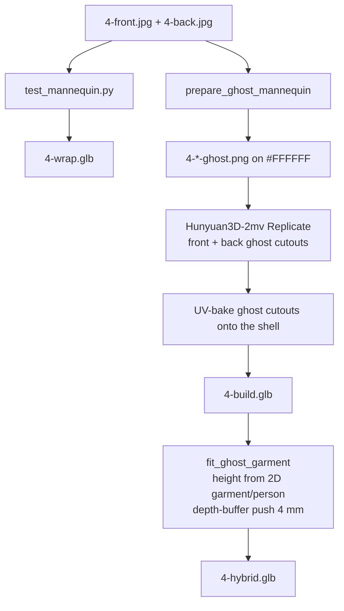

# Template 4 — Black lace-trim satin slip (Ghost v1)

Opaque enough that a mask can cut the person out and still leave the print. Burgundy bag, hair over the straps, peach skin fringes. This is the template that proved **cut the dress in 2D, then ask Hunyuan for a dress** — instead of reconstructing a person and carving in 3D.

Method write-up: [`_docs/ghost-v1.md`](../_docs/ghost-v1.md). Isolation code: `pipeline/preprocess.py` `prepare_ghost_mannequin`.

The picker relabels the last two Model buttons: **Ghost build** and **Ghost + Mannequin** (`GHOST_TEMPLATE = 4` in `frontend/js/app.js`).

## What’s in the viewer

| Button | File | What it is |
| --- | --- | --- |
| Texture wrap | `frontend/assets/models/4-wrap.glb` | Baseline catalog projection on `female_base_mesh.glb`. Kept so the ghost dress has something to sit next to. |
| Ghost build | `frontend/assets/models/4-build.glb` | Hollow 3D dress from Hunyuan, textured with the 2D ghost cutouts. No mannequin. |
| Ghost + Mannequin | `frontend/assets/models/4-hybrid.glb` | That shell scaled onto the white mannequin; back pulled past seat and shoulder blades. |
| Ghost thumbs | `frontend/assets/templates/4-{front,back}-ghost.png` | The 2D isolation, shown under the catalog photos. |

Catalog photos: `frontend/assets/templates/4-{front,back}.jpg` and `-full.jpg`.

## Why this garment is hard

Feeding the catalog photo to Hunyuan builds a **person**. Carving that person in 3D to get the dress punches holes through straps, lace, and the hem. Ghost v1 does the cut in 2D first, composites the floating dress on `#FFFFFF`, and only then reconstructs.

This path **fails on Template 1**: SegFormer calls the sheer leopard mesh skin, so punching “skin” deletes the print. T1 went to Ghost v2 (Flux rewrite) instead. T4 is the opaque-satin version of the same idea.

## Flow that shipped



## 1. 2D isolation

**Code:** `prepare_ghost_mannequin` in `pipeline/preprocess.py`. Standalone, no 3D:

```bash
poetry run python scripts/test_ghost_mannequin.py \
  --front frontend/assets/templates/4-front.jpg \
  --back  frontend/assets/templates/4-back.jpg \
  --out-dir outputs/ghost_mannequin
```

Steps:

1. **rembg** cuts the person from the studio background.
2. **SegFormer B2 clothes** labels dress / hair / face / limbs / shoes / bag. **`u2net_cloth_seg`** brings thin spaghetti straps back when SegFormer drops them.
3. Skin-colored pixels on the outer edge of the mask, measured in CIE LAB against the limbs, are stripped so a peach halo does not bake into the satin. Dark strap pixels connected to the bodice are grown back on.
4. Bag and hair that sit on the dress become an occlusion mask. Nearest garment color pre-fill, then **LaMa** on Replicate (`allenhooo/lama`). OpenCV TELEA is the fallback.
5. 2 px morphological erosion + Gaussian feather. Thin straps kept. Composite onto pure `#FFFFFF` (what Hunyuan expects).

Intermediates also live under `outputs/ghost_mannequin/` (`*_ghost.png`, `*_raw_mask.png`, `*_occlusion_mask.png`).

## 2. Texture wrap (baseline)

**Code:** `scripts/test_mannequin.py`. File dated 13 Oct — oldest wrap still in the demo.

```bash
poetry run python scripts/test_mannequin.py \
  frontend/assets/templates/4-front.jpg \
  frontend/assets/templates/4-back.jpg \
  --out frontend/assets/models/4-wrap.glb
```

Same baker as T3 wrap. Dress is paint on the body. Useful only as the “before ghost” control.

## 3. Ghost build

**Code:** `scripts/run_hybrid_poc.py --ghost-prepass`. Reconstructs from the white-background cutouts, UV-bakes those cutouts onto the mesh. For ghost mode, writing `*-build.glb` exports the **standalone textured dress**, not a clothed person (`run_hybrid_poc.py` special-cases `--ghost-prepass`).

```bash
poetry run python scripts/run_hybrid_poc.py \
  --front frontend/assets/templates/4-front.jpg \
  --back  frontend/assets/templates/4-back.jpg \
  --ghost-prepass \
  --provider replicate \
  --out frontend/assets/models/4-hybrid.glb
```

That command also writes `4-build.glb` unless `--no-write-build`. Raw reconstruction copy: `outputs/hybrid_src/4-build.glb`. Untextured ghost mesh: `outputs/4-build-ghost-raw.glb`.

## 4. Ghost + mannequin

**Code:** `fit_ghost_garment` in `pipeline/garment_extractor.py`.

The Hunyuan shell is only as tall as the dress in the photo. `align_ghost_to_mannequin` scales by the 2D garment-to-person height and sets it down by the hem-to-foot offset. Vertices inside the torso are pushed 4 mm outside the skin (`CLEARANCE`).

Push uses **depth buffers**, not normals / `mesh.contains()`. `mannequins/female_base_mesh.glb` is a thick double-skinned shell (~5 mm, outer + inner, joined) with scrambled face winding. Ray-parity inside tests are wrong on it.

There is no face carving. Export is mannequin + dress. The back of the shell is pulled out past the seat and shoulder blades so the body does not show through.

T4 hybrid on disk is dated 27 Oct (after the 24 Oct ghost build) — later fit pass, same isolation idea.

## Dead ends (do not redo)

- Reconstruct the clothed person, then carve the dress in 3D — holes in straps, lace, hem.
- Running this isolation on Template 1 — SegFormer “skin” is the print.
- Using vertex normals or `trimesh.contains()` on `female_base_mesh.glb`.
- `trimesh.split()` on these meshes.

## What to steal for a later flow

1. **Opaque garment + occlusion (bag, hair) → Ghost v1.** Fast, no image-gen rewrite, Hunyuan sees only the dress.
2. **Sheer / printed mesh → Ghost v2 (T1), not this.** The branch is “can a mask keep the print?”
3. **White `#FFFFFF` canvas** as the Hunyuan contract.
4. **Fit with depth/SDF, never this mannequin’s normals.**
5. Keep a wrap control next to the ghost so you can see what isolation + reconstruct actually bought.
