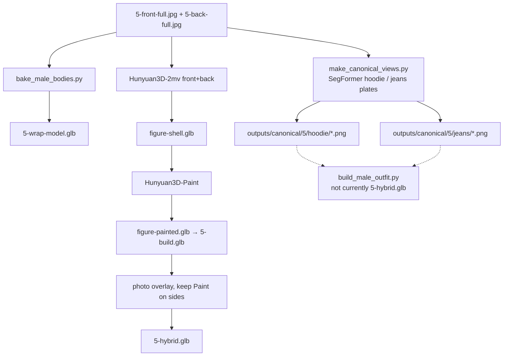

# Template 5 — Beige hoodie and jeans

Male figure, GUESS teddy-bear hoodie, dark jeans, shoes. Two garments, hands over the pocket, a chest graphic that must not be redrawn. This is the **male / two-piece** test, and the only template with a Body switch (currently Model only).

Canonical plates (no Flux): `pipeline/canonical.py` `write_outfit_plates`. Wrap: `scripts/bake_male_bodies.py`. Modular shells (not what Hybrid shows today): `scripts/build_male_outfit.py`.

## What’s in the viewer

| Button | File | What it is |
| --- | --- | --- |
| Texture wrap → Model | `frontend/assets/models/5-wrap-model.glb` | Catalog photos on the textured male body. Face, hair, shoes stay. |
| Texture wrap → Basic | `5-wrap-basic.glb` | **Button is disabled.** `bake_male_bodies.py` can write it; the GLB is not in `frontend/assets/models/` (only a `5-wrap-basic.png` preview). |
| Full build | `frontend/assets/models/5-build.glb` | Whole figure from Hunyuan3D-2mv (front+back) + Hunyuan3D-Paint. Same idea as T3 full build. |
| Hybrid | `frontend/assets/models/5-hybrid.glb` | Same full figure as Full build, with real hoodie/jeans photos on front and back. Face, hair, hands, sides keep Paint. **No separate mannequin.** |

The info modal still says “Full build & Hybrid: Not generated”. Ignore that; `HAS_BUILD` and `HAS_HYBRID` include 5 and the files are dated 28 Oct.

Catalog photos: `frontend/assets/templates/5-{front,back}.jpg` and `-full.jpg`.

Male bodies: `mannequins/mannequin_male.glb` (Basic) and `mannequins/mannequin_male_model.glb` (Model). Body/face/eyes on the model ship at 0.001 scale while hair and shoes are at 0.01; `bake_male_bodies.py` scales those parts ×10 before baking. Only `body_body2_0`, `body_arm_0`, `body_leg_0` receive garment photos. UVs on those parts are UDIM tiles; the baker `mod`s them into 0–1.

## Why this garment is hard

Two classes (hoodie, jeans) that overlap, arms in front of the graphic, a print that Flux would happily redraw. T1/T2-style Kontext **rewrites** are the wrong tool for the teddy. Plates are **cut from the real photos**: SegFormer class mask, LaMa only on arm pixels that sit on the cloth.

A single watertight Hunyuan person (Full build) does not give you two garments you can rig. `build_male_outfit.py` is the modular attempt (separate hoodie and jeans shells, 4 mm off the body, hoodie also 4 mm off the jeans). `_docs/step1-handoff.md` says that script was **not the last write** of `5-hybrid.glb`. The viewer Hybrid is the T3-style overlay on the painted figure.

## Flow that shipped



## 1. Canonical plates (not Flux)

**Code:** `outfit_plate` / `write_outfit_plates` in `pipeline/canonical.py`. Entry with no flags:

```bash
poetry run python scripts/make_canonical_views.py
```

Defaults: `5-front-full.jpg` / `5-back-full.jpg` → `outputs/canonical/5/{hoodie,jeans}/`.

For each class: SegFormer label, morphological close to find hand-sized gaps, fill **only arm pixels** that sit on the cloth (LaMa). Graphic, pocket stitching, and the other garment are left alone. Studio background stays white. Writes `front.png`, `back.png`, and `*-hole.png`.

Kontext prompts for hoodie/jeans exist in `PROMPTS` in the same file (keep the teddy, don’t invent a back print). They are **not** what produced the plates on disk. Use them only if a cut cannot recover a class.

Also on disk from later reconstruct/paint experiments:

| File | Role |
| --- | --- |
| `outputs/canonical/5/hoodie-shell.glb` / `hoodie-painted.glb` | Isolated hoodie mesh |
| `outputs/canonical/5/jeans-shell.glb` / `jeans-painted.glb` | Isolated jeans mesh |
| `outputs/canonical/5/figure-shell.glb` / `figure-painted.glb` | Whole-person Hunyuan + Paint (source of Full build) |

## 2. Texture wrap

**Code:** `scripts/bake_male_bodies.py`, not `test_mannequin.py`.

```bash
poetry run python scripts/bake_male_bodies.py
```

Writes `5-wrap-model.glb` and would write `5-wrap-basic.glb`. Older stills: `5-wrap.png` (25 Oct), `5-wrap-basic.png` (26 Oct). The Body switch hides unless template is 5 and method is wrap; Basic is forced off in `apply()`.

**Works:** real hoodie/jeans pixels on a male body, graphic intact.  
**Does not:** garment drape. Sleeves and jeans are paint on the limbs.

## 3. Full build

Same two-stage as Template 3: Hunyuan3D-2mv on Replicate (front+back, grey person) then Hunyuan3D-Paint on Modal. `figure-painted.glb` and `5-build.glb` are the same size and timestamp (28 Oct 08:08–08:09) — display copy of the painted figure.

Hint in the picker: “The man, hoodie, and jeans as one Hunyuan3D-2mv mesh.”

## 4. Hybrid in the viewer

Same finish as T3 hybrid: `--no-extract` style overlay. Real hoodie and jeans photos on the front and back of that figure; face, hair, hands, and grazing sides keep the Paint atlas. One mesh, no mannequin, no white fill. Same timestamp as Full build.

This is **not** two garment nodes sitting on `mannequin_male_model.glb`.

## 5. Modular outfit (code exists, not the demo Hybrid)

**Code:** `scripts/build_male_outfit.py`. SDF cache: `mannequins/male_body_bake.sdf.npz`.

```bash
poetry run python scripts/build_male_outfit.py
```

Reads `hoodie-painted.glb` / `jeans-painted.glb` if present, else the grey shells. Projects the real plates on top (`keep_mesh_texture` when Paint exists). Scales each shell to the full figure (hair to shoes). Jeans: 4 mm off the body. Hoodie: 4 mm off the body **and** 4 mm off the jeans where they overlap. Arms stay in the field so sleeves lift off the arms. Writes **`frontend/assets/models/5-hybrid.glb`** (destructive).

`_docs/step1-handoff.md`: this script was not rerun after the SDF work, so the file in the viewer is the previous overlay. If you run it, you replace Hybrid.

## Dead ends (do not redo)

- Flux-rewriting the teddy graphic.
- Enabling Basic in the UI before `5-wrap-basic.glb` exists.
- Assuming Hybrid is the modular hoodie+jeans assembly — look at the GLB (one painted figure vs named `hoodie`/`jeans` geoms).
- Running `build_male_outfit.py` casually; it overwrites the demo Hybrid.
- Female mannequin path (`female_base_mesh.glb`) for this template.

## What to steal for a later flow

1. **Cut real pixels for graphics.** Kontext is for “empty the dress”, not “keep this teddy”.
2. **Per-class plates** (hoodie vs jeans) as the input to modular reconstruction — the T4 ghost idea, two garments.
3. **Layered SDF clearance** (garment vs body, then garment vs the other garment) is the production-shaped piece; it is just not what Hybrid displays yet.
4. T3’s shape-then-Paint-then-photo-overlay is a valid **person** hybrid when you are not ready to split garments.
5. Male model scale/UDIM gotchas belong in the baker, not in every caller.
