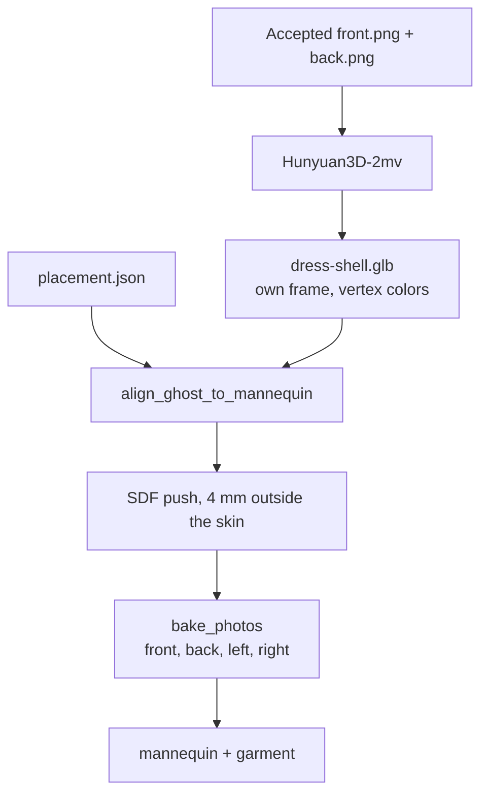

# Shells — the garment mesh, before it is fitted or painted

A shell is the dress as geometry. It is the GLB that Hunyuan3D-2mv returns from the accepted front and back photos, written to disk and then left alone. Fit, clearance, and the photo bake all run on a copy. None of them invent a new hem, a new slit, or a new strap.

The two reference shells:

| File | Garment | What it is |
| --- | --- | --- |
| `outputs/canonical/1/dress-shell.glb` | Leopard lace mini | Hunyuan from the accepted white-background front and back. 27 Oct 09:24. |
| `outputs/canonical/2/dress-shell-whitebg.glb` | Black sheer midi | Hunyuan from the accepted white-background front and back. 29 Oct 12:32. |

Both are about 1.5 MB, about 40,000 vertices and 80,000 faces, y-up, vertex-colored, and closed. They are not on the mannequin. Their height runs from about −1 to +1, which is Hunyuan’s own frame. The mannequin runs from about 0 to 1.80. A shell that already sits on the body is a later file (`dress-fitted.glb`, `1-hybrid.glb`), not the shell.

Stage 1 ([`stage_one.md`](stage_one.md)) has to be finished first. Hunyuan only sees `front.png` and `back.png`. Left and right are texture, and sending them in as extra views tears the hem.

## What Hunyuan is asked to do

**Code:** `via_replicate` in `pipeline/reconstruct.py`. **CLI:** `scripts/run_hybrid_poc.py`.

| Setting | Value |
| --- | --- |
| Model | `tencent/hunyuan3d-2mv:71798fbc3c9f7b7097e3bb85496e5a797d8b8f616b550692e7c3e176a8e9e5db` |
| Where | Replicate. `REPLICATE_API_TOKEN` in `.env`. |
| Inputs | `front_image`, `back_image` only |
| `file_type` | `glb` |
| `remove_background` | true. The canvas is white, so the dress is what remains. |
| `target_face_num` | 80000 |
| `octree_resolution` | 384 |
| Retries | A 429 waits 11 seconds and tries twice more. |

`--build-only` writes those bytes and exits. The flag that matters next to it is `--no-cutout` (or `--product-shot`, which also skips the local rembg cut). Either one uploads the accepted PNGs. Without one of them, `run_hybrid_poc.py` first runs a person cutout and Hunyuan never sees the empty-dress photo.

`--save-build` is the output path. If you omit it, the GLB lands at `outputs/poc_build.glb` and the next run overwrites it.

```bash
poetry run python scripts/run_hybrid_poc.py \
  --front outputs/canonical/1/dress/front.png \
  --back  outputs/canonical/1/dress/back.png \
  --provider replicate \
  --no-cutout \
  --build-only \
  --save-build outputs/canonical/1/dress-shell.glb
```

Swap the two paths for the black midi, and write `outputs/canonical/2/dress-shell-whitebg.glb` if you do not want to clobber another file. Do not pass `--left`, `--right`, `--sheer-fill`, or `--shell fitted`. Do not run this over a shell you already accepted.

Other providers exist and did not make these two files. `--provider modal` calls the Modal app `garment-3d-reconstruction`. `--provider trellis` and `--provider hf` are TRELLIS.2, a clothed person from the front photo, and the back is invented. That person is `1-build.glb`. It is not a dress shell.

## The leopard shell

Inputs: `outputs/canonical/1/dress/front.png` and `back.png`. Those are the Flux Kontext empty-dress photos from stage 1, not the catalog shots of the woman. No gray fill. The leopard mesh is already dark enough that the white canvas is the background, so `remove_background` keeps the slip.

On disk:

| | |
| --- | --- |
| Vertices / faces | 40,000 / 80,000 |
| Closed | yes, 0 boundary edges, consistent winding |
| Euler | 0. One tunnel, neck through hem. That is an empty dress, not a solid person. |
| Extents | 1.15 × 1.99 × 0.72 m (width × height × depth) |
| Color | Hunyuan vertex colors. Thrown away at bake time. |

This file is the shape inside both viewer meshes for template 1:

- `frontend/assets/models/1-hybrid.glb` (27 Oct 12:41) is this shell, fitted, with a planar 4-view bake.
- `outputs/canonical/1/dress-fitted.glb` (29 Oct) is the same shell again, with a cylindrical 4-view bake. No second Hunyuan call.

Reuse it. Do not reconstruct to change the flanks. Flanks are the bake.

```bash
poetry run python scripts/run_hybrid_poc.py \
  --front outputs/canonical/1/dress/front.png \
  --back  outputs/canonical/1/dress/back.png \
  --left  outputs/canonical/1/dress/left.png \
  --right outputs/canonical/1/dress/right.png \
  --placement outputs/canonical/1/dress/placement.json \
  --product-shot --provider skip \
  --build outputs/canonical/1/dress-shell.glb \
  --no-write-build --unwrap-mode cylindrical \
  --collision sdf \
  --out outputs/canonical/1/dress-fitted.glb
```

`--provider skip` reads `--build` and does not call Replicate. `--no-write-build` keeps this from also writing a `*-build.glb`.

## The black-midi shell

Inputs: `outputs/canonical/2/dress/front.png` and `back.png`. The back is the Kontext turn of the accepted front (`T2_BACK_FROM_FRONT`), not an edit of the catalog back. Again, no gray fill.

The command that produced the bytes, originally saved as `dress-shell.glb`:

```bash
poetry run python scripts/run_hybrid_poc.py \
  --front outputs/canonical/2/dress/front.png \
  --back  outputs/canonical/2/dress/back.png \
  --provider replicate \
  --no-cutout \
  --build-only \
  --save-build outputs/canonical/2/dress-shell.glb
```

That file was then copied to `dress-shell-whitebg.glb` before a later run overwrote `dress-shell.glb`. The copy is the one to keep.

| | `dress-shell-whitebg.glb` | `dress-shell.glb` (later, not the reference) |
| --- | --- | --- |
| When | 29 Oct 12:32 | 29 Oct 12:40 |
| Input | accepted white PNGs | `hunyuan-front.png` / `hunyuan-back.png`, sheer areas filled RGB `(24, 24, 24)` |
| Faces | 80,000 | 80,000 |
| Euler | −26 | 0 |
| Extents | 0.76 × 1.99 × 0.45 | 0.75 × 1.99 × 0.48 |

Euler −26 means the white-background mesh has extra tunnels. Hunyuan’s background removal treats white showing through the midriff and the slit as holes, and those holes are in the mesh. That is the shape that matches the photo: a sheer dress, not a solid black tube. The 12:40 file filled those windows so the volume is one tunnel from neck to hem. It is a different shell. Do not replace `dress-shell-whitebg.glb` with it, and do not pass `--sheer-fill` when the goal is this mesh.

`dress-fitted-whitebg.glb` (same minute, 12:32) is this shell after fit and bake. `dress-fitted.glb` (12:46) is the gray-fill shell after fit and bake. The Hybrid button for template 2 loads `dress-fitted.glb` (the filled shell after fit). That is the failure in the shop. The shell to start from is `dress-shell-whitebg.glb`. Old Hybrid command and what not to rerun: [Template2.md](Template2.md). Redo: [handoff_t2_and_satin.md](handoff_t2_and_satin.md).

## What the shell becomes in the final GLB

The final file is two nodes, `mannequin` and the garment, from `export_hybrid` in `pipeline/export_glb.py`. The garment node is the shell after three steps. The triangle count stays the Hunyuan count, minus crumbs.



### 1. Alignment

`align_ghost_to_mannequin` in `pipeline/garment_extractor.py`.

The shell only covers the dress, so it cannot be scaled as a full body. The scale is the dress box over the person box in `placement.json`:

- Garment height on the body = mannequin height × `(g_bottom − g_top) / (bottom − top)`.
- Hem height = mannequin floor + mannequin height × `(bottom − g_bottom) / (bottom − top)`.
- X and Z are centered on the torso, not on the shell’s bounding box.

`lift_m` (0.10 m on these dresses, `DRESS_LIFT_M`) shifts `g_top` and `g_bottom` up together before that math, so the bust and the hem move by the same amount. A translation of the mesh by itself, without moving those rows, makes the bake sample the wrong part of the photo.

### 2. Clearance

`push_clearance` in `pipeline/sdf_collision.py`, 4 mm (`DEFAULT_CLEARANCE`). The mannequin is a double skin with scrambled winding, so this is a signed-distance field, not `mesh.contains()` and not a ray test. Vertices inside the skin move out. The silhouette — straps, hem, slit, neck opening — stays the shell’s silhouette.

`run_hybrid_poc.py --product-shot` pushes from the photo hem through the bust (`dress_band`). The default hip-to-armpit band hid the leopard mini inside the hips.

### 3. Texture

`bake_photos` in `pipeline/texture_bake.py` builds new UVs and projects the four accepted PNGs. Hunyuan’s vertex colors are not kept. Planar UVs leave the flanks empty (the leopard hybrid). Cylindrical UVs give the left and right photos somewhere to land (the leopard side-fill, and the midi fits).

Left and right still do not go back into Hunyuan. A bad flank is a bake problem. A bad hem is a shell problem, and a rebake will not fix it.

### Two fitters, and what each one deletes

`scripts/run_hybrid_poc.py` calls `fit_ghost_garment`. After alignment it drops components smaller than 2% of the largest, and it drops faces whose center is more than `HIP_X` (0.35 m) off the midline. A bow or a hip that sticks out past that can disappear here even though it is in the shell.

`scripts/build_outfit.py` is the later fitter. It calls `align_ghost_to_mannequin` and `push_clearance` directly, then bakes. It does not apply that 0.35 m cut. Point it at a kept shell with `--shell`:

```bash
poetry run python scripts/build_outfit.py \
  --config configs/templates/dress_slip.json \
  --shell dress=outputs/canonical/2/dress-shell-whitebg.glb \
  --out outputs/canonical/2/dress-from-whitebg.glb
```

The config only supplies plates, clearance, and unwrap. The mesh is the file you pass. `--placed` skips alignment, and is only for a shell that is already in mannequin space. These two are not.

## What is not one of these shells

| Thing | Why it is something else |
| --- | --- |
| `--shell fitted` / `fitted_shell` in `pipeline/garment_deformer.py` | Cuts a band of the mannequin’s outer skin and nudges it toward Hunyuan. The dress then exists as paint on the body. No skirt volume, no hem edge, no bow. `outputs/fit_compare/1-sdf-shell.glb` is that experiment. Do not use it when a Hunyuan shell already looks like the garment. |
| `extract_garment` | Cuts dress faces out of a clothed person with a depth buffer. That was the first hybrid prototype. The leopard and midi shells were reconstructed as the empty dress. |
| `1-wrap.glb` | The four photos projected onto the mannequin. There is no garment mesh. |
| `1-build.glb` | TRELLIS.2 person. Independent of the dress shell. |
| `outputs/canonical/2/dress-shell.glb` | The gray-fill rebuild. Same provider, different input, solid tube. |
| `front-hole.png` style masks | Ghost v1. They never enter this step. |

## Look at the shell before fitting it

Open the raw GLB (`http://127.0.0.1:8000/?src=/outputs/canonical/1/dress-shell.glb`). Check the mesh, not the color. Hunyuan’s vertex colors are a preview.

- One garment. No arms, no head, no second blob.
- Straps are there. A 384³ grid drops straps that were a pixel or two in the photo; if they are gone, the shell is not this one.
- Hem length matches the accepted front: upper thigh for the leopard, mid-calf for the midi.
- The back matches the accepted back. The midi’s slit is on the front only.
- The leopard shell is one tunnel (neck to hem). The midi reference is the white-background file, with the sheer openings still open.

Then fit. If the fitted dress is the right shape and the sides are blank, change the unwrap. If the fitted dress is the wrong shape, the shell was the wrong file, or the fitter cut it. Do not call Hunyuan again to repaint a flank.
