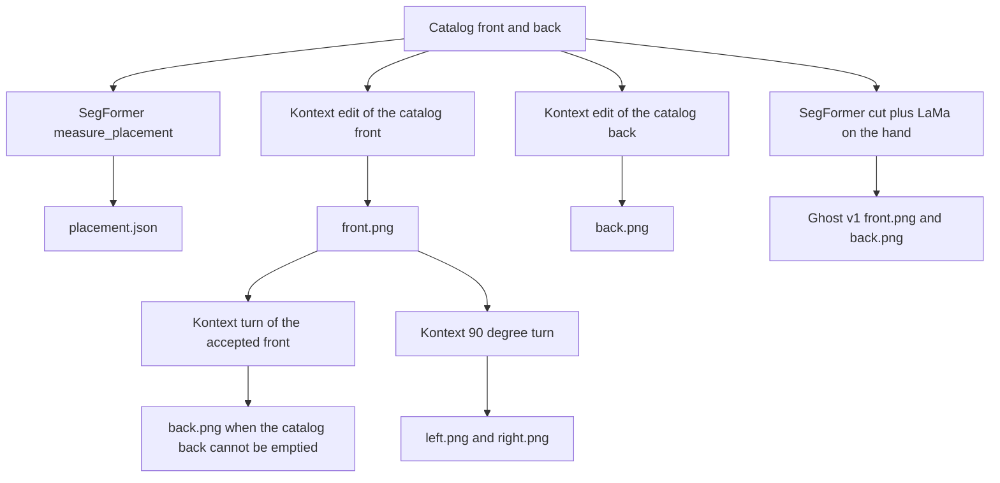

# Stage 1 — ideal images, before any 3D model

Stage 1 turns catalog photographs into the pictures a reconstructor can use: an empty garment, hanging straight, on white, in frame. Nothing in this stage builds a mesh, calls Hunyuan, or touches the mannequin.

The files this page is about:

| Outfit | Folder | What is on disk |
| --- | --- | --- |
| Leopard lace mini (template 1) | `outputs/canonical/1/dress/` | `front.png`, `back.png`, `left.png`, `right.png`, `placement.json` |
| Black sheer midi (template 2) | `outputs/canonical/2/dress/` | same four views, plus `placement.json`, plus `hunyuan-front.png` / `hunyuan-back.png` |
| Guess sequin mini | `outputs/canonical/guess_dress/dress/` | `front.png`, `back.png`, `placement.json` only. No side views were kept. |

The three leopard photos attached with the placement file (front, left, right, person box `967×1450`, dress rows `301–794`) are the template 1 plates. That JSON is `outputs/canonical/1/dress/placement.json`. Template 2 is a different dress.

Look at the PNGs and stop. A bad plate is not fixed in 3D.

## What every accepted plate has to be

- One garment, empty. No woman, no mannequin, no arms, no legs.
- Plain white background. Full garment in frame, centered, not cropped.
- Hanging straight. The catalog pose (hip, lean, hand on the cloth) is gone.
- The design parts that a mask would delete are still there: straps, lace, sequins, bow, slit, hem length.
- Fabric stays that fabric. Sequins are not redrawn as satin. Leopard mesh is not deleted as skin. Sheer stays sheer, with white showing through, not a solid panel.

`placement.json` is not a picture. It is the catalog photo’s person box and dress box, in that photo’s pixels. The ideal PNGs are a different size from the catalog. The fitter pastes each PNG back into this box before it measures the dress against the body. Do not hand-edit it to match the PNG size.

## Models

| Job | Model | Where it runs |
| --- | --- | --- |
| Rewrite a catalog photo into an empty garment, or turn an accepted front into a back or a side | `black-forest-labs/flux-kontext-pro` | Replicate. `REPLICATE_API_TOKEN` in `.env`. |
| Person box and dress box for `placement.json`. Also the Ghost v1 cut. | `mattmdjaga/segformer_b2_clothes` | Local CPU. MPS logits on this machine are wrong, so `pipeline/clothes_seg.py` forces CPU. |
| Fill a hand-sized hole in a Ghost v1 cut | `allenhooo/lama` (`cdac78a1…`) | Replicate. OpenCV TELEA if the call fails. |
| Fill enclosed sheer holes for Hunyuan only | none | Local OpenCV flood fill in `pipeline/sheer_prepass.py`. |

Kontext is an edit, not text-to-image. Every call sends the source photo as `input_image` plus a prompt. Settings in `kontext_edit` (`pipeline/canonical.py`):

- `aspect_ratio`: `match_input_image`
- `output_format`: `png`
- `prompt_upsampling`: false
- `safety_tolerance`: `2` for a normal front or side. `5` when turning an accepted front into a back, and when the second “remove the leftover body” pass runs.
- A 429 is retried twice, 12 seconds apart.

The returned PNG is not the catalog size. Kontext wrote the leopard and the black midi at `832×1248` from `967×1450` catalogs, and the Guess plates at `880×1184` from `1800×2400` catalogs. That resize is expected. Placement stays in catalog pixels.

Entry point for all of the commands below:

```bash
poetry run python scripts/make_canonical_views.py …
```

Poetry owns the env. Run from the repo root.

## Three ways a view gets made



### 1. Edit the catalog photo

`write_dress_views` in `pipeline/canonical.py`.

- Front is always an edit of the real front photo.
- Back is an edit of the real back photo, unless `back_from_front` is set.
- The prompt is the method. It has to name straps, hem length, print, bow, and slit, and it has to say the garment is empty and straight. A generic “remove the person” prompt lengthens hems and invents a second skirt.

This is how the leopard front, the Guess front, the Guess back, and the template 2 front were made.

### 2. Turn an accepted front

Same function, different source image.

- Left and right are always turns of the **accepted** `front.png`, never of the catalog photo and never of the back. They are texture for the flanks. They are not sent to Hunyuan. A generated profile often comes back as a three-quarter; if it does, delete it and do not bake it.
- Template 2’s back is also a turn of the accepted front (`T2_BACK_FROM_FRONT`). Editing the catalog back left a body inside the sheer skirt.

Asking for only `left` and `right` does not rewrite `front.png`, `back.png`, or `placement.json`, as long as `placement.json` already exists. Asking for `front` or `back` again overwrites those files and remeasures placement from the catalog.

### 3. Cut the catalog photo (Ghost v1)

`outfit_plate` / `dress_plate` in `pipeline/canonical.py`. No Kontext.

SegFormer keeps one clothing class, drops face, hair, and bag, composites onto `#FFFFFF`, and LaMa fills only arm pixels that sit inside the cloth. Real pixels survive, including a chest graphic (`paste_graphic` when `preserve_graphics` is set).

This is the hoodie and jeans path (`write_outfit_plates`, the default of `make_canonical_views.py` with no flags). It is the wrong first step for the leopard slip: SegFormer labels that mesh as skin and deletes the print. It was tried on the Guess dress and rejected; `front-hole.png` and `back-hole.png` in the Guess folder are that leftover mask, not plates.

`pipeline/preprocess.py` is an older cut that uses rembg (`u2net`) plus `u2net_cloth_seg`. It is not what wrote the three folders above.

`write_class_views` cuts with SegFormer and then runs Kontext on the cutout. Do not start there. Kontext then completes whatever the mask already destroyed.

## Leopard lace mini — the attached plates

Catalog: `test_images/front.jpg` and `test_images/back.jpg` (`967×1450`). The same garment is `frontend/assets/templates/1-front-full.jpg` and `1-back-full.jpg`.

Prompts: `DRESS_PROMPTS` in `pipeline/canonical.py` (front, back, left, right). They lock a short mini: upper-thigh hem, two thin straps, black lace bust, leopard mesh, scalloped lace hem, no second skirt. An earlier prompt grew a midi and was thrown out. Do not regenerate `front.png` or `back.png` unless they are missing.

```bash
poetry run python scripts/make_canonical_views.py --dress \
  --front test_images/front.jpg \
  --back test_images/back.jpg \
  --out outputs/canonical/1/dress
```

`--views` defaults to `front,back,left,right`. To rebuild only the sides from the accepted front:

```bash
poetry run python scripts/make_canonical_views.py --dress \
  --out outputs/canonical/1/dress \
  --views left,right
```

What each file is:

| File | Source image | Prompt |
| --- | --- | --- |
| `front.png` | catalog front | `DRESS_PROMPTS["front"]` |
| `back.png` | catalog back | `DRESS_PROMPTS["back"]` |
| `left.png` | accepted `front.png` | `DRESS_PROMPTS["left"]` |
| `right.png` | accepted `front.png` | `DRESS_PROMPTS["right"]` |
| `placement.json` | SegFormer on the two catalog photos, before the edits | `measure_placement` |

`placement.json` has no `"framed"` key. The fitter still treats it as a product shot because a `"front"` block is present (`load_fit_views` in `pipeline/prepass.py`). `grow_sheer` pulls the leopard mesh back into the dress mask so the hem is the lace, not the skin showing through it. `cx` is the median x of the torso band (25th–50th percentile of the person rows), not the center of the dress box.

There is no `hunyuan-*.png` here. The cloth is photographed sheer-over-print, and the accepted PNGs are what later stages see. Do not sheer-fill them. Gray would flatten the leopard.

`*-aligned.png` in that folder is a later paste into the person frame, not a Kontext output.

## Black sheer midi — `outputs/canonical/2/dress`

This is not the leopard dress. Catalog: `frontend/assets/templates/2-front-full.jpg` and `2-back-full.jpg`.

Prompts: `T2_PROMPTS`, `T2_BACK_FROM_FRONT`, and `T2_EMPTY` in `pipeline/canonical.py`. They lock solid black, no floral print, midi length (not a mini, not the floor), one high slit on the front, empty interior, white showing through the sheer.

```bash
poetry run python scripts/make_canonical_views.py --template 2
```

| File | Source image | Prompt |
| --- | --- | --- |
| `front.png` | `2-front-full.jpg` | `T2_PROMPTS["front"]` |
| `back.png` | the accepted `front.png`, not the catalog back | `T2_BACK_FROM_FRONT`, `safety_tolerance=5` |
| `left.png` | accepted `front.png` | `T2_PROMPTS["left"]` |
| `right.png` | accepted `front.png` | `T2_PROMPTS["right"]` |
| `placement.json` | SegFormer on both catalog photos | `measure_placement` |

If a pass keeps the dress and also the legs visible through it:

```bash
poetry run python scripts/make_canonical_views.py --template 2 --strip-body
```

That runs `strip_body` with `T2_EMPTY` on the existing front and back, then rebuilds left and right from the cleaned front. It does not remeasure placement.

### Sheer fill, reconstruction only

Hunyuan’s background removal treats white-through-sheer as a hole and tunnels the midriff. `pipeline/sheer_prepass.py` writes a second pair and leaves the accepted PNGs alone:

- Enclosed light regions (midriff, hollow interior) become RGB `(24, 24, 24)`. Mid-gray `#808080` was treated as a second object and still tunneled.
- The gap between the spaghetti straps stays open, because it touches the top border.
- Opaque cloth and the straps stay dark. Straps in the top 28% of the frame are dilated 11 px so a coarse voxel grid can see them. Dilating the whole dress closed the slit.
- Exterior background stays white.

On disk those copies are `hunyuan-front.png` and `hunyuan-back.png` (29 Oct). The current helper writes `<side>-recon.png` when a sheer outfit goes through `write_prepass` (`configs/templates/dress_slip.json` is `material_type: sheer`, so `plan_prepass` sets `vision_plate`). `recon_plate_paths` prefers `*-recon.png`, then the plain plate. The named `hunyuan-*.png` files are the copies that were actually handed to Hunyuan for template 2.

Do not point a texture bake at the gray copies. They exist so the shape pass sees a solid silhouette.

## Guess sequin mini

Catalog: `test_images/guess_front.png` and `test_images/guess_back.png` (`1800×2400`).

Prompts live on the garment, not in `DRESS_PROMPTS`: `configs/templates/guess_dress.json`. Opaque sequin, `prepass_mode: ghost_v2`, so there is no gray vision plate. `lift_m` and `background_max` in that file are fit and bake settings. They do not change the PNGs.

```bash
poetry run python scripts/make_canonical_views.py \
  --config configs/templates/guess_dress.json \
  --front test_images/guess_front.png \
  --back test_images/guess_back.png
```

`write_prepass` calls `write_dress_views` with `views=("front", "back")` only, using `garment.prompts`. Then, because `empty_prompt` is set, `strip_body` runs that second prompt on each PNG (`safety_tolerance=5`) to drop a figure the first edit left inside the dress. `_mark_framed` sets `"framed": "product"` on `placement.json`.

| File | Source image | Prompt |
| --- | --- | --- |
| `front.png` | `test_images/guess_front.png`, then a second edit of itself | `prompts.front`, then `empty_prompt` |
| `back.png` | `test_images/guess_back.png`, then a second edit of itself | `prompts.back`, then `empty_prompt` |
| `placement.json` | SegFormer on the two catalog photos | `measure_placement`, then `"framed": "product"` |

The back is edited from the catalog back on purpose. The bow and the open upper back are on that photo. Turning the front would invent them. The accepted back still closed the upper back with sequin. That was kept. Do not “fix” the plate unless asked.

`front-hole.png` and `back-hole.png` are the Ghost v1 hand masks from `dress_plate`. They are not plates. Do not send them anywhere.

There is no `left.png` or `right.png` in this folder. A Kontext turn of the accepted front came back as a three-quarter with crossed straps, which would paint the flank with the front of the dress. Those files were deleted. The prompts for a true profile are `prompts.left` and `prompts.right` in `guess_dress.json`. To try again without touching the accepted front, back, or placement:

```bash
poetry run python - << 'PY'
from pathlib import Path
from pipeline.env import load_env
load_env()
from pipeline.canonical import write_dress_views
from pipeline.outfit import load_outfit

outfit = load_outfit("configs/templates/guess_dress.json")
write_dress_views(
    Path("test_images/guess_front.png"),
    Path("test_images/guess_back.png"),
    Path("outputs/canonical/guess_dress/dress"),
    views=("left", "right"),
    prompts=outfit.garments[0].prompts,
    label="dress",
)
PY
```

`views` must be only `left` and `right`. If the results are three-quarter views, delete them before any bake. `load_fit_views` will pick up `left.png` and `right.png` automatically and project them onto the side normals.

Guess is opaque. Do not run sheer fill. Do not run Ghost v1. Do not reuse `DRESS_PROMPTS` or `T2_PROMPTS`.

## What to check before leaving stage 1

- Front: the garment from the catalog front, empty, straight, hem the same length as the photo.
- Back: the garment from the catalog back, unless this is template 2, in which case the back is a turn of the front and has no slit.
- Left and right, when they exist: a real side, one strap, hem unchanged. A view that still shows the front of the bust is not a side.
- Straps are present. Lace, leopard, sequins, or the bow are present and not simplified into a flat color.
- `placement.json` still describes the catalog frame (`967×1450` for templates 1 and 2, `1800×2400` for Guess), not the smaller PNG.

Then stop. Shape is the next stage, and it only receives front and back.
